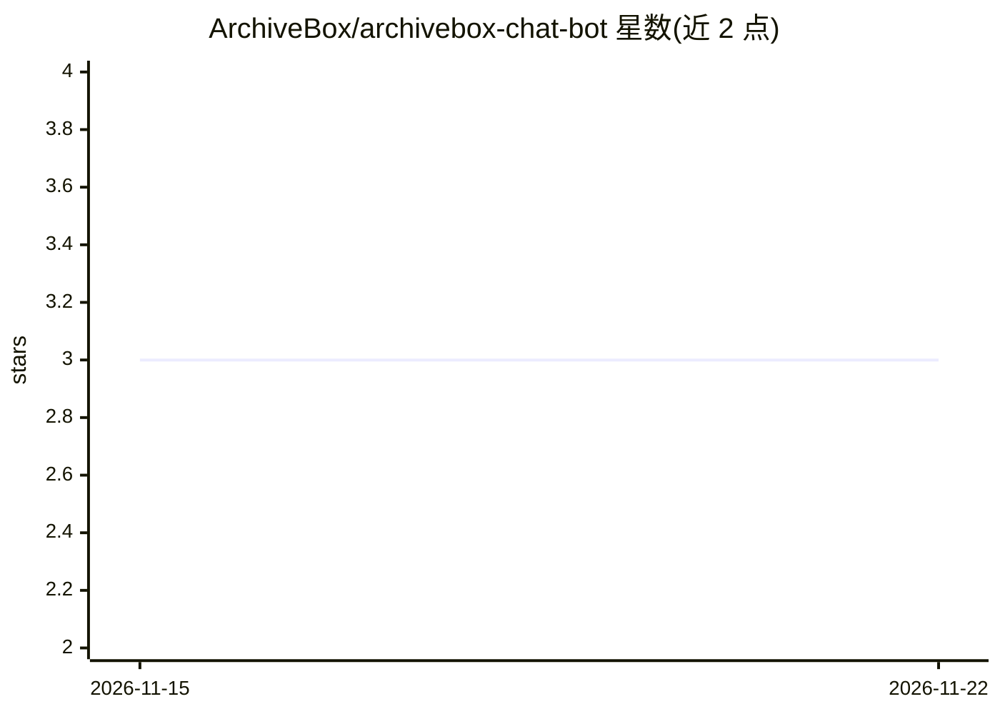

# ArchiveBox/archivebox-chat-bot

⭐ — · [GitHub]() · 组织维护

**聊天群组链接归档机器人：自动保存与检索群聊中的 URL**

与 ArchiveBox 网页归档服务配合的聊天机器人：在 Slack、Telegram、WhatsApp、IRC、iMessage、Messenger、Beeper、Email 等聊天渠道中监听消息，将共享的 URL 自动捕获为快照存入私有归档，支持自动打标签（来源、用户、频道）、/save 与 /search 命令检索已存页面。通过 Docker Compose 部署，带管理控制台配置连接与权限；另含 ArchiveBox AI Bot 入口。iMessage 需 Mac 且需手动配置 imsg 与 SSH。

## 筛选速览

| 维度 | 判定 | 备注 |
|---|---|---|
| AI 角色 | `ai-enhanced` | 去掉 AI 部分产品仍成立 |
| 许可风险 | `permissive` | — |
| 部署形态 | `self-host` | docker 或自建部署 |
| 模型依赖 | — | README 未给出锁定关系 |
| 硬件要求 | — | 无带数字的原话,不猜 |
| 安装摩擦 | `low` | 无编译、无系统依赖或容器化 |
| 成熟度 | — | 结构信号不足 |

## 能力要点

- 支持 Slack、Discord、Zulip、Telegram、WhatsApp、IRC、iMessage、Messenger、Beeper、Email 等多渠道接入
- 自动归档群聊/私聊中的 URL 并按来源自动打标签
- /save、/search、/auto 等聊天命令控制归档与检索
- 管理控制台管理连接、权限、任务与凭据恢复

## 适用场景

- 群聊里分享的技术文章自动存进私有归档
- 按关键词搜索以前在群里分享过的网页快照
- 通过邮件转发链接归档到私人 ArchiveBox

## 场景标签

`聊天机器人` `网页抓取` `工作流自动化` · 领域:效率与自动化

## 证据(README 行号)

> L3: **URLs in your group chats → saved to your private archive.**
> L13: - **mention @ArchiveBox in any thread** → saves all URLs found in the last 10 messages
> L20:  🐳 Docker → ArchiveBox URL + API key → chat provider

## 星数曲线

2026-11-15 3 → 2026-11-22 3（+0）

---
*卡片 v1 · prompt 1.4 · 生成 2026-11-22 · 置信度 high · 依据 README sha `22724631b3b8` · [字段定义](../../DATASET.md)*
