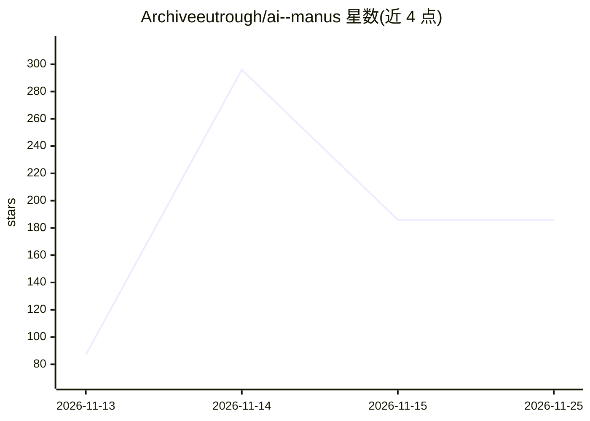

# Archiveeutrough/ai--manus

⭐ 186 · Apache-2.0 · 推送 2026-11-15 · [GitHub](https://github.com/Archiveeutrough/ai--manus) · 个人维护

**面向个人用户的自主 AI Agent，代为执行代码与浏览器操作**

README 以宣传口吻描述的通用 AI Agent：声称可在用户授权下编写并执行脚本、控制浏览器完成表单填写与信息收集，并执行多步骤日常任务，面向家庭、学习与轻量办公场景，使用者无需编程背景。README 提及跨会话记忆模式与代码/浏览器流程衔接。未给出任何安装命令、代码位置、模型接入方式或仓库文件说明，仅提供下载名与配置步骤的抽象描述，可验证的实现细节缺失。

## 筛选速览

| 维度 | 判定 | 备注 |
|---|---|---|
| AI 角色 | `ai-native` | 本体是模型或模型工具 |
| 许可风险 | `permissive` | Apache-2.0 |
| 部署形态 | `None` |  |
| 模型依赖 | — | README 未给出锁定关系 |
| 硬件要求 | — | 无带数字的原话,不猜 |
| 安装摩擦 | `low` | 无编译、无系统依赖或容器化 |
| 成熟度 | — | 结构信号不足 |

## 能力要点

- 声称支持自主编写并执行代码完成任务
- 声称支持浏览器导航、表单填写与信息收集
- 声称跨会话保持任务模式记忆
- 面向小规模家庭/学习/轻办公任务

## 适用场景

- 让代理代为执行重复性的脚本与网页操作
- 研究资料收集与多页面信息汇总
- 日常小事的自动任务委派

## 场景标签

`AI 助手` `浏览器自动化` · 领域:效率与自动化

## 证据(README 行号)

> L10: - **Autonomous Code Execution:** Manus AI agent runs code on its own to complete tasks, so you can focus on decisio
> L18: Manus is an autonomous AI agent designed to run code and control a browser on your behalf. Instead of acting like a

## 星数曲线

2026-11-13 87 → 2026-11-25 186（+99）

---
*卡片 v1 · prompt 1.4 · 生成 2026-11-17 · 置信度 low · 依据 README sha `a3d88e202bf0` · [字段定义](../../DATASET.md)*
