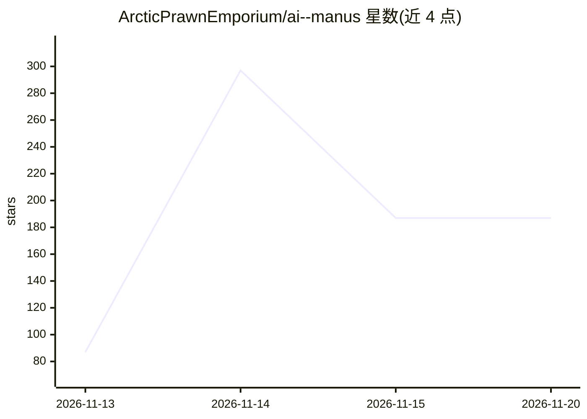

# ArcticPrawnEmporium/ai--manus

⭐ 187 · Apache-2.0 · 推送 2026-11-15 · [GitHub](https://github.com/ArcticPrawnEmporium/ai--manus) · 个人维护

**面向个人用户的自主 AI Agent：代跑代码与控制浏览器**

自称 Manus 的自主 AI 代理产品介绍页：用户以自然语言下达指令，代理自主编写并执行脚本、控制浏览器（导航网页、填表、采集信息），并可跨会话记忆工作流模式，完成多步骤任务。定位为家庭、学习与轻量办公场景的后台个人助手，而非企业平台。README 给出系统兼容表（最低 4GB 内存、双核 CPU）与上手步骤，但未提供具体安装命令、代码仓库结构或模型接入方式等技术细节。

## 筛选速览

| 维度 | 判定 | 备注 |
|---|---|---|
| AI 角色 | `ai-native` | 本体是模型或模型工具 |
| 许可风险 | `permissive` | Apache-2.0 |
| 部署形态 | `None` |  |
| 模型依赖 | — | README 未给出锁定关系 |
| 硬件要求 | — | 无带数字的原话,不猜 |
| 安装摩擦 | `low` | 无编译、无系统依赖或容器化 |
| 成熟度 | — | 结构信号不足 |

## 能力要点

- 自主执行代码与浏览器操作的多步骤任务
- 跨会话记忆工作流模式，无需重复说明
- 沙盒环境中运行各类工具与操作（来自仓库描述）
- 面向家庭/学习/轻办公场景，非开发者向

## 适用场景

- 让代理代为完成网页信息采集与表单填写等重复操作
- 学习和研究场景下整理笔记、运行小脚本
- 小型日常任务的后台委派与自动化

## 场景标签

`AI 助手` `浏览器自动化` `编码 Agent` · 领域:效率与自动化

## 证据(README 行号)

> L10: - **Autonomous Code Execution:** Manus AI agent runs code on its own to complete tasks, so you can focus on decisio
> L18: Manus is an autonomous AI agent designed to run code and control a browser on your behalf. Instead of acting like a

## 星数曲线

2026-11-13 87 → 2026-11-20 187（+100）

---
*卡片 v1 · prompt 1.4 · 生成 2026-11-17 · 置信度 mid · 依据 README sha `0f78ee3a5dd2` · [字段定义](../../DATASET.md)*
