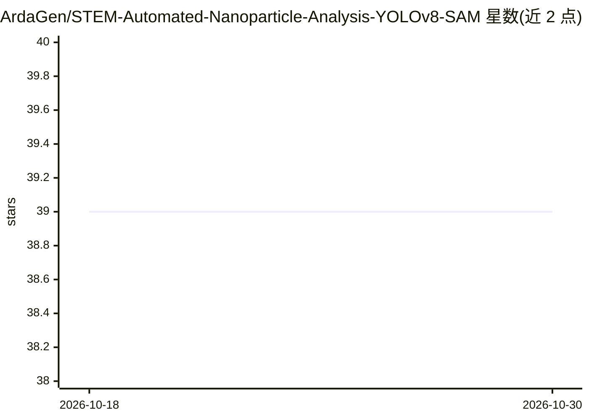

# ArdaGen/STEM-Automated-Nanoparticle-Analysis-YOLOv8-SAM

⭐ 39 · Python · MIT · 推送 2026-04-13 · [GitHub](https://github.com/ArdaGen/STEM-Automated-Nanoparticle-Analysis-YOLOv8-SAM) · 组织维护

**S/TEM 电镜图像纳米颗粒自动检测分割与粒径分析工作流**

面向扫描透射电镜（S/TEM）图像的机器学习工作流：用 YOLOv8 检测纳米颗粒并生成 box prompts，再由 SAM 完成分割，随后统计粒径与面积分布；数据脚本读取 .emd/.emi/.dm3/.dm4 格式电镜文件。工作流在 Pt/石墨、Ru/氧化铝等不同催化衬底材料上检测颗粒。另提供配套软件 nanoDetect（需填表获取安装包），支持 CPU 运行，边界处被截断的颗粒不计入分析。代码依赖 PyTorch、RosettaSciIO、Ultralytics 与 segment-anything。

## 筛选速览

| 维度 | 判定 | 备注 |
|---|---|---|
| AI 角色 | `ai-native` | 本体是模型或模型工具 |
| 许可风险 | `permissive` | MIT |
| 部署形态 | `library` | 以包/库形式分发 |
| 模型依赖 | — | README 未给出锁定关系 |
| 硬件要求 | `cpu-ok` | |
| 安装摩擦 | `low` | 无编译、无系统依赖或容器化 |
| 成熟度 | — | 结构信号不足 |

## 能力要点

- YOLOv8 检测 + SAM 分割的两阶段纳米颗粒分析
- 支持 .emd/.emi/.dm3/.dm4 电镜数据格式读取
- 输出粒径与面积分布统计
- 材料无关工作流，适配不同催化衬底上的颗粒

## 适用场景

- 电镜图像中纳米颗粒的自动检测与分割
- 统计纳米催化剂颗粒的粒径与面积分布
- 批量处理不同衬底材料的 S/TEM 图像

## 场景标签

`目标检测` · 领域:感知与多模态

## 证据(README 行号)

> L5: Repository for automated nanoparticle analysis of Scanning Transmission Electron Microscopy (S/TEM) images using YOL
> L16:  Run YOLOv8 on the S/TEM images and generate box prompts
> L17:  Segment nanoparticles using box prompts and SAM

## 星数曲线

2026-10-18 39 → 2026-10-30 39（+0）

---
*卡片 v1 · prompt 1.4 · 生成 2026-10-25 · 置信度 mid · 依据 README sha `ff59f81ee7f8` · [字段定义](../../DATASET.md)*
