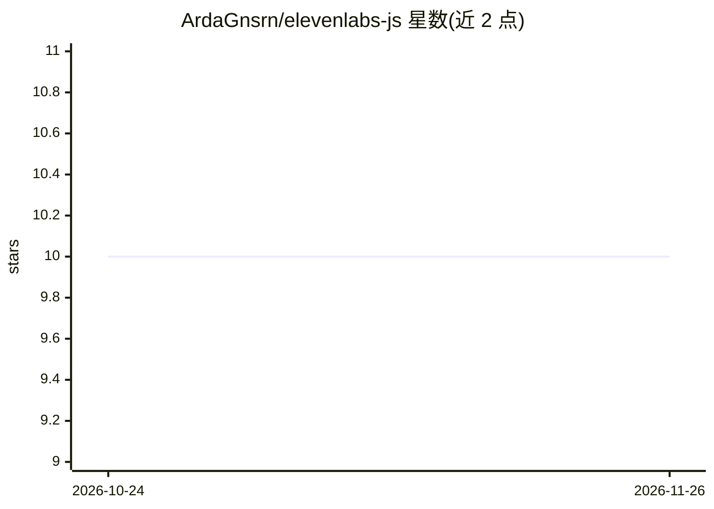

# ArdaGnsrn/elevenlabs-js

⭐ 10 · JavaScript · MIT · 推送 2026-06-18 · [GitHub](https://github.com/ArdaGnsrn/elevenlabs-js) · [官网](https://www.npmjs.com/package/elevenlabs-js) · 个人维护

**NodeJS 开发者调用 ElevenLabs 文本转语音 API 的 SDK**

面向 NodeJS 环境的开源包，封装 elevenlabs.io Text to Speech API：提供 textToSpeech 流式生成语音、模型/声音列表查询、声音删除与设置编辑、用户与订阅信息查询共 10 个方法，通过 setApiKey 设置密钥后调用。默认模型为 eleven_multilingual_v2，语音参数含 stability、similarity_boost、style、use_speaker_boost。以 npm 包形式分发，MIT 许可，测试框架为 jest。

## 筛选速览

| 维度 | 判定 | 备注 |
|---|---|---|
| AI 角色 | `ai-ecosystem` | LLM/agent 周边工具 |
| 许可风险 | `permissive` | MIT |
| 部署形态 | `library` | 以包/库形式分发 |
| 模型依赖 | — | README 未给出锁定关系 |
| 硬件要求 | — | 无带数字的原话,不猜 |
| 安装摩擦 | `low` | 无编译、无系统依赖或容器化 |
| 成熟度 | — | 结构信号不足 |

## 能力要点

- 封装 10 个 elevenlabs.io API 方法（含流式 textToSpeech）
- 支持配置 modelId 与 stability/similarity_boost/style/speaker_boost 语音参数
- API 返回可保存为文件或使用 pipe 流
- 另有同项目 PHP Laravel 版本 elevenlabs-laravel

## 适用场景

- 在 NodeJS 应用里把文本合成为语音音频文件
- 查询和管理 ElevenLabs 账户下的声音与语音设置
- 获取账户订阅与用户信息

## 场景标签

`语音合成` · 领域:内容生成

## 证据(README 行号)

> L10: This is an Open Source NodeJS package for elevenlabs.io Text to Speech API. You can
> L27: ## Supported Methods
> L63: - Set your API key using `elevenLabs.setApiKey('YOUR_API_KEY')`.

## 星数曲线

2026-10-24 10 → 2026-11-26 10（+0）

---
*卡片 v1 · prompt 1.4 · 生成 2026-11-20 · 置信度 high · 依据 README sha `d0bbd30b6319` · [字段定义](../../DATASET.md)*
