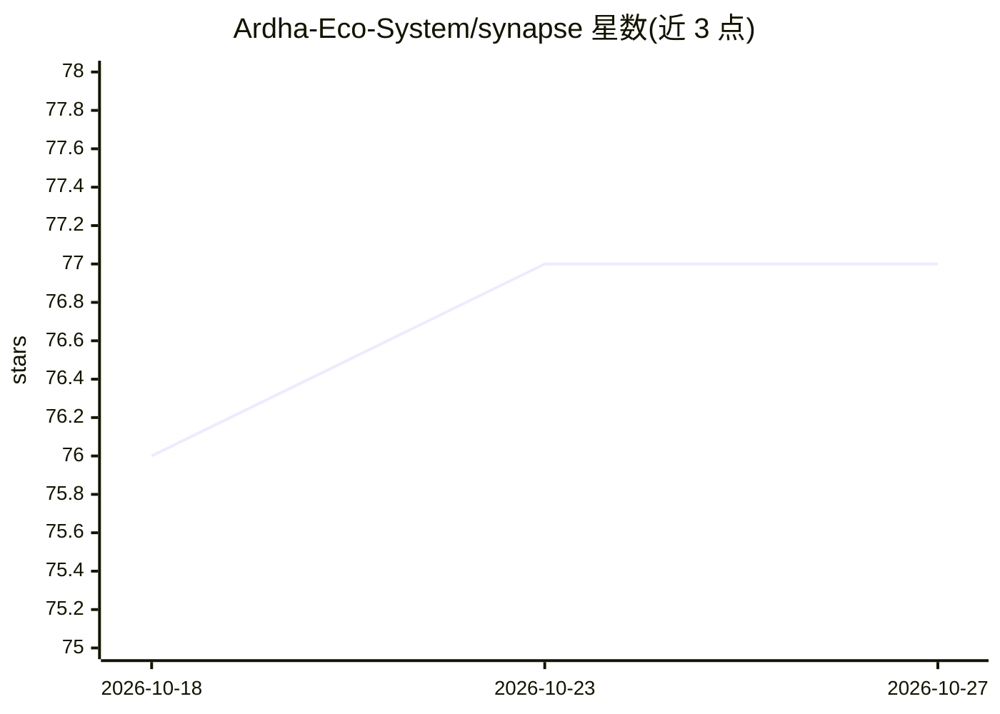

# Ardha-Eco-System/synapse

⭐ 77 · Python · MIT · 推送 2026-10-19 · [GitHub](https://github.com/Ardha-Eco-System/synapse) · 组织维护

**AI agent 的自托管时序知识图谱记忆插件**

基于 Graphiti + FalkorDB 的 agent 记忆系统，以 Hermes Agent 记忆 provider 插件形式提供，支持 Brain Mode（替代原生记忆）与 Supplementary Mode（叠加原生记忆）两种模式。核心是海马体层：九种受生物记忆启发的算法，包括 salience 评分、Ebbinghaus 遗忘曲线、睡眠重放式离线巩固、CA3 子图扩展的模式补全、再巩固与检索诱导遗忘等。支持任意 OpenAI 兼容端点（Ollama/OpenRouter/vLLM 等），需 Docker 运行 FalkorDB，性能数字为 projected 估算。

## 筛选速览

| 维度 | 判定 | 备注 |
|---|---|---|
| AI 角色 | `ai-ecosystem` | LLM/agent 周边工具 |
| 许可风险 | `permissive` | MIT |
| 部署形态 | `self-host` | docker 或自建部署 |
| 模型依赖 | local-ok | 支持本地模型 |
| 硬件要求 | — | 无带数字的原话,不猜 |
| 安装摩擦 | `low` | 无编译、无系统依赖或容器化 |
| 成熟度 | — | 结构信号不足 |

## 能力要点

- 九种生物启发记忆算法（salience、遗忘曲线、巩固、模式补全等）经单一 Hippocampus 协调器接入运行时
- 时序知识图谱支持 at_time 历史时点查询
- Brain/Supplementary 两种接入模式，原生记忆写入自动镜像到图谱
- 自托管 FalkorDB（Docker），兼容任意 OpenAI 兼容 LLM 端点

## 适用场景

- 给 Hermes Agent 加上会遗忘、会巩固的长期记忆
- 让 agent 回答某时点为真的历史事实
- 本地化部署 agent 记忆，数据不出机器

## 场景标签

`Agent 记忆` `知识图谱` · 领域:Agent 开发

## 证据(README 行号)

> L33: > *Built on Graphiti + FalkorDB. Ships as a Hermes Agent memory provider plugin — drops in with zero core changes.*
> L110:   provider: synapse

## 星数曲线

2026-10-18 76 → 2026-10-27 77（+1）

---
*卡片 v1 · prompt 1.4 · 生成 2026-10-24 · 置信度 mid · 依据 README sha `5dca65f402db` · [字段定义](../../DATASET.md)*
