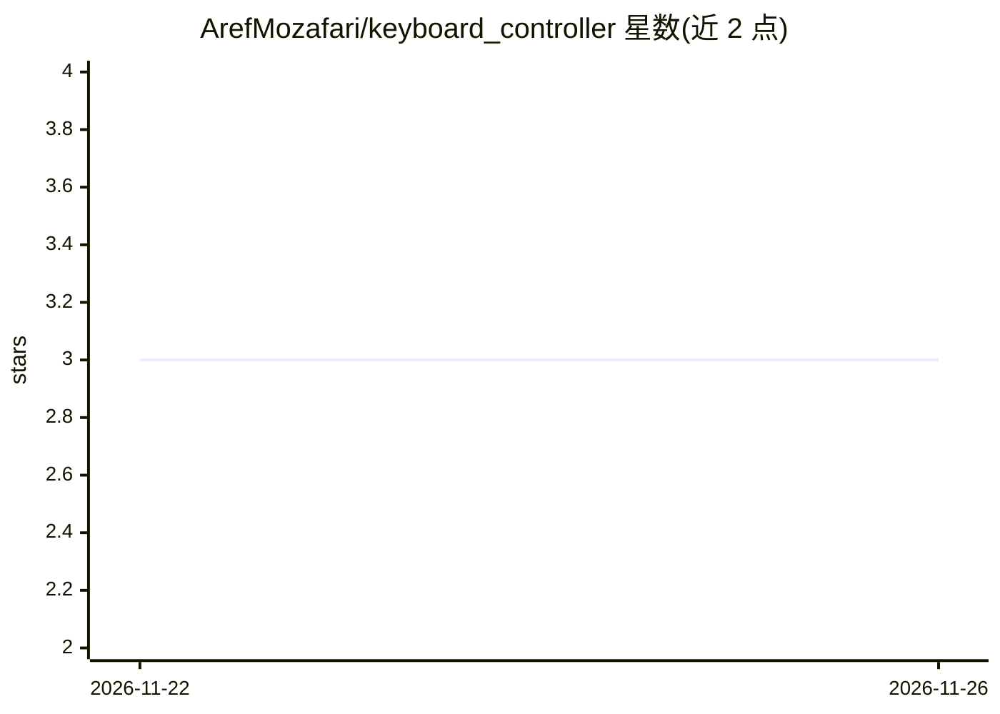

# ArefMozafari/keyboard_controller

⭐ 3 · Dart · MIT · 推送 2026-11-17 · [GitHub](https://github.com/ArefMozafari/keyboard_controller) · 个人维护

**Flutter 聊天键盘交互组件：iOS 式下滑收起键盘与 AI 聊天行为**

一个 Flutter 包（支持 iOS 与 Android），提供手指拖拽跟随收起键盘的交互式 dismiss、键盘开合时消息列表保持位置的聊天视图、随键盘移动的输入 composer，以及 AI 聊天流式回答的列表跟随与 prompt 置顶行为。通过公开平台 API 实现（iOS UIKit 交互 dismiss、Android inset 动画控制），以 `flutter pub add` 安装，要求 Flutter 3.29；Android 交互式 dismiss 仅在 API 30+ 可用，iPad 浮动键盘不被跟踪。

## 筛选速览

| 维度 | 判定 | 备注 |
|---|---|---|
| AI 角色 | `ai-enhanced` | 去掉 AI 部分产品仍成立 |
| 许可风险 | `permissive` | MIT |
| 部署形态 | `None` |  |
| 模型依赖 | — | README 未给出锁定关系 |
| 硬件要求 | — | 无带数字的原话,不猜 |
| 安装摩擦 | `low` | 无编译、无系统依赖或容器化 |
| 成熟度 | — | 结构信号不足 |

## 能力要点

- 拖拽消息列表时键盘跟随手指的交互式 dismiss（iOS/Android）
- 键盘开合与拖拽时聊天列表保持稳定、新消息不扰动阅读位置
- AI 聊天行为：流式回答列表跟随、pinToTop 置顶已发送 prompt、isAtEnd 驱动跳转按钮
- 暴露键盘状态 listenable：高度、目标高度、进度（0-1）与 phase

## 适用场景

- 为 Flutter 聊天应用实现下滑收起键盘的交互
- 构建流式输出的 AI 聊天界面，回答生成时保持列表跟随
- 处理键盘弹出时消息列表跳动的问题

## 场景标签

`聊天机器人` · 领域:对话与助手

## 证据(README 行号)

> L3: iOS-style interactive keyboard dismiss for Flutter, on iOS **and Android**: swipe the chat down
> L33: - **AI chat behaviours.**
> L5: a composer that rides the keyboard, and AI chat behaviours. It is the Flutter counterpart of

## 星数曲线

2026-11-22 3 → 2026-11-26 3（+0）

---
*卡片 v1 · prompt 1.4 · 生成 2026-11-22 · 置信度 high · 依据 README sha `f3e2e5a19fc6` · [字段定义](../../DATASET.md)*
