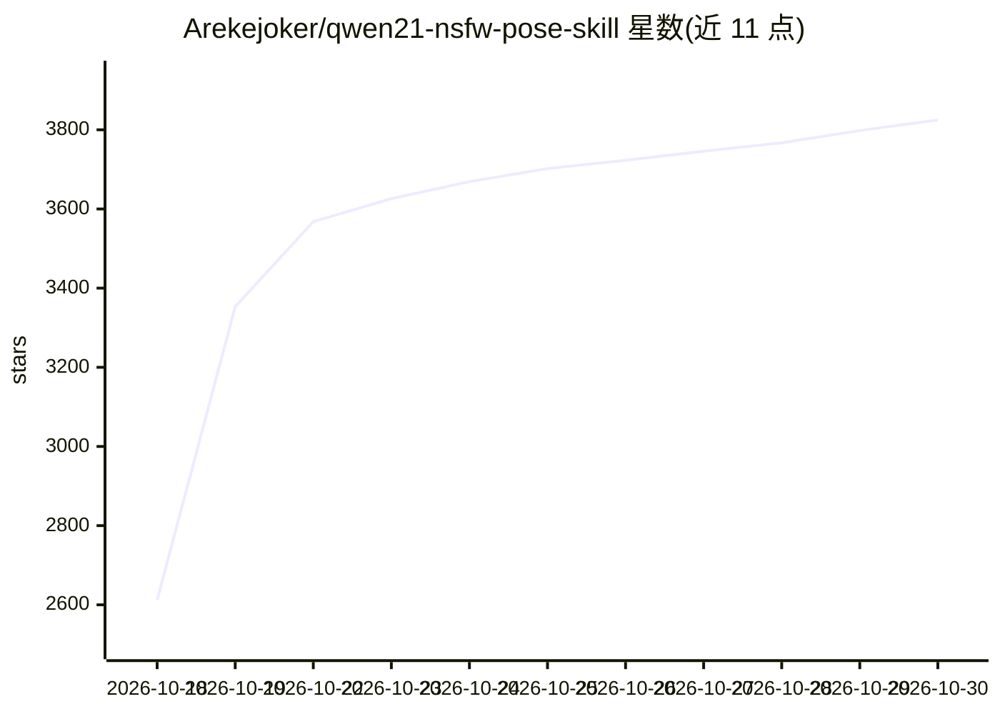

# Arekejoker/qwen21-nsfw-pose-skill

⭐ 3,825 · Python · Apache-2.0 · 推送 2026-10-26 · [GitHub](https://github.com/Arekejoker/qwen21-nsfw-pose-skill) · 个人维护 · 中文 README

**Qwen-Image 2.1 本地 NSFW/姿势出图配方：提示词+LoRA+136 姿势控制**

面向 Claude Code / Codex / Cursor / OpenClaw 等 agent 与人类手动用户的 Qwen-Image 2.1 出图技能包：基于 ComfyUI 与 int8 底模，提供作者级提示词配方、NSFW LoRA、136 个 3D 姿势库及 VNCCS 人偶姿势控制，分 T2I/换姿势 Edit/脚本姿势迁移/PoseStudio 四条路线，附自检脚本与安装指南。硬件门槛为 12GB 显存起步、模型文件约 16GB、硬盘约 40GB；原创代码 Apache-2.0，第三方模型与素材不在许可覆盖内。

## 筛选速览

| 维度 | 判定 | 备注 |
|---|---|---|
| AI 角色 | `ai-native` | 本体是模型或模型工具 |
| 许可风险 | `permissive` | Apache-2.0 |
| 部署形态 | `None` |  |
| 模型依赖 | — | README 未给出锁定关系 |
| 硬件要求 | `gpu-8g` | |
| 安装摩擦 | `low` | 无编译、无系统依赖或容器化 |
| 成熟度 | — | 结构信号不足 |

## 能力要点

- 四条出图路线：T2I+LoRA / Edit 换姿势 / 脚本姿势迁移 / VNCCS PoseStudio
- 136 个 3D 姿势库（4 个 HuggingFace 公开仓库 + 55 个手工精选）
- doctor.py 逐项自检 ComfyUI 连通性、底模/LoRA、姿势库等
- 复刻并验证过 Civitai 作者样图，附元数据与工作流

## 适用场景

- 用 agent 或命令行在本地复现 Civitai 风格的 NSFW 出图
- 给已有角色图换姿势且保留身份
- 通过 3D 人偶指定精确姿势生成图片

## 场景标签

`图像生成` `提示工程` · 领域:Agent 开发

## 证据(README 行号)

> L5: **Qwen-Image 2.1 本地 NSFW / 姿势出图完整配方** — 作者级提示词结构 + NSFW LoRA + 136 个 3D 姿势库 + VNCCS 人偶精确姿势控制。
> L7: 基于 ComfyUI + `qwen_image_2.1_int8_convrot` 底模（与 Civitai 作者同款底模），复刻并验证过 Civitai 作者样图（2026-10-12）。
> L9: - 适用：Claude Code / Codex / Cursor / OpenClaw（agent 技能）+ 人类手动使用

## 星数曲线

2026-10-18 2,612 → 2026-10-30 3,825（+1,213）

---
*卡片 v1 · prompt 1.4 · 生成 2026-10-20 · 置信度 high · 依据 README sha `18cf505518f9` · [字段定义](../../DATASET.md)*
