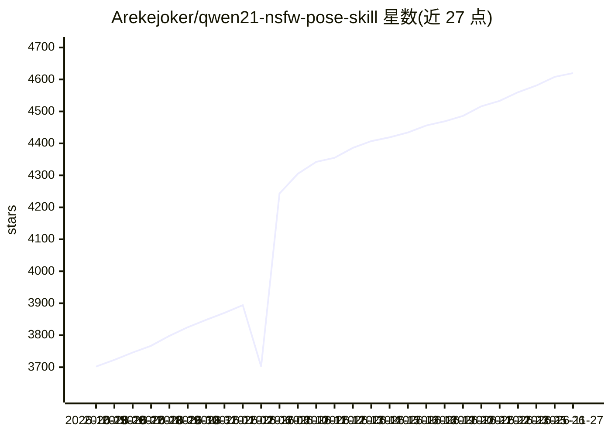

# Arekejoker/qwen21-nsfw-pose-skill

⭐ 4,620 · Python · Apache-2.0 · 推送 2026-10-26 · [GitHub](https://github.com/Arekejoker/qwen21-nsfw-pose-skill) · 个人维护 · 中文 README

**Qwen-Image 2.1 NSFW/姿势出图的 agent 技能与配方库**

提供一套基于 ComfyUI 与 qwen_image_2.1_int8_convrot 底模的本地出图配方：作者级提示词结构、NSFW LoRA、136 个 3D 姿势库与 VNCCS 人偶姿势控制。以 agent 技能（SKILL.md）形式供 Claude Code/Codex/Cursor/OpenClaw 使用，也可由人类手动运行脚本。含四条路线（T2I/Edit/姿势迁移/VNCCS PoseStudio）、自检脚本 doctor.py 与完整安装指南。硬件要求：最低 NVIDIA 12GB 显存 + 32GB 内存，模型文件合计约 16GB。

## 筛选速览

| 维度 | 判定 | 备注 |
|---|---|---|
| AI 角色 | `ai-native` | 本体是模型或模型工具 |
| 许可风险 | `permissive` | Apache-2.0 |
| 部署形态 | `None` |  |
| 模型依赖 | — | README 未给出锁定关系 |
| 硬件要求 | `gpu-8g` | |
| 安装摩擦 | `low` | 无编译、无系统依赖或容器化 |
| 成熟度 | — | 结构信号不足 |

## 能力要点

- 四条出图路线：T2I、Edit、脚本姿势迁移、VNCCS PoseStudio
- 136 个 3D 姿势库（HuggingFace 4 个公开仓库 + 55 个手工精选）
- 提示词配方含大胆度阶梯 L0–L3 与 7 要素结构要求
- doctor.py 自检 ComfyUI 连通性、底模/LoRA、姿势库等缺失项

## 适用场景

- 本地复现 Civitai 作者的 NSFW/姿势出图效果
- 为已有角色图保脸换姿势
- 通过 3D 人偶指定精确姿势生成图片
- 在 agent 工具中以技能形式调用出图配方

## 场景标签

`图像生成` `提示工程` · 领域:Agent 开发

## 证据(README 行号)

> L7: **Qwen-Image 2.1 本地 NSFW / 姿势出图完整配方** — 作者级提示词结构 + NSFW LoRA + 136 个 3D 姿势库 + VNCCS 人偶精确姿势控制。
> L11: - 适用：Claude Code / Codex / Cursor / OpenClaw（agent 技能）+ 人类手动使用

## 星数曲线

2026-10-25 3,702 → 2026-11-27 4,620（+918）

---
*卡片 v1 · prompt 1.4 · 生成 2026-11-22 · 置信度 high · 依据 README sha `7edec8f59115` · [字段定义](../../DATASET.md)*
