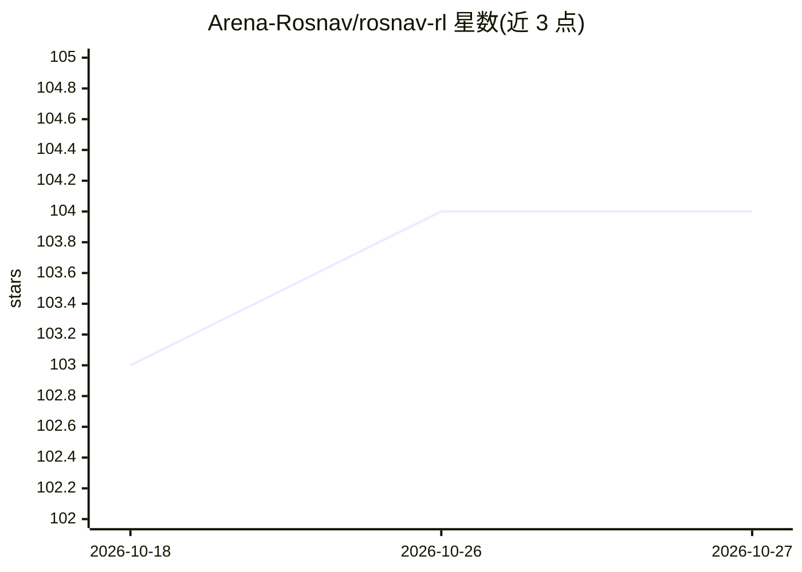

# Arena-Rosnav/rosnav-rl

⭐ 104 · Python · 推送 2026-10-23 · [GitHub](https://github.com/Arena-Rosnav/rosnav-rl) · [官网](https://discord.gg/XDg24s5D) · 组织维护

**面向科研的 ROS2 机器人 DRL 导航模块化训练与部署框架**

在 ROS 2 Humble 上构建的强化学习机器人导航工具包：将 Stable-Baselines3、sb3-contrib、DreamerV3 等任意 RL 后端包装进统一管线，覆盖传感器数据采集与预处理、类型化观测空间、可组合奖励塑形（YAML 声明式配置，Pydantic v2 校验）、启动期拓扑排序的观测依赖解析，以及基于 Optuna 的超参搜索。训练好的 agent 可经 `ros2 run` 启动的 action server 以 GetCommand 服务输出 Twist 速度指令。需 ROS 2 Humble、Python 3.10+、uv，主要面向机器人导航研究者，与 Arena-Rosnav 生态配套。

## 筛选速览

| 维度 | 判定 | 备注 |
|---|---|---|
| AI 角色 | `ai-ecosystem` | LLM/agent 周边工具 |
| 许可风险 | `permissive` | — |
| 部署形态 | `None` |  |
| 模型依赖 | — | README 未给出锁定关系 |
| 硬件要求 | — | 无带数字的原话,不猜 |
| 安装摩擦 | `low` | 无编译、无系统依赖或容器化 |
| 成熟度 | — | 结构信号不足 |

## 能力要点

- 统一 RL_Model 接口：SB3 ↔ DreamerV3 ↔ 自定义后端互换无需改动训练代码
- YAML 声明式定义传感器/观测/奖励/算法，各层独立可替换
- Optuna 集成超参搜索（MedianPruner/HyperbandPruner）与最优参数导出
- 一条命令启动 action server 部署训练好的 agent（GetCommand 服务返回 Twist）

## 适用场景

- 在 ROS 2 机器人上训练与部署强化学习导航策略
- 对比 PPO 与 DreamerV3 等不同算法在同一导航任务上的表现
- 快速实验自定义奖励项或观测空间而无需重写训练管线

## 场景标签

`强化学习` · 领域:训练与推理

## 证据(README 行号)

> L16: > RosNav-RL wraps any reinforcement learning framework - Stable-Baselines3,
> L38: - **Wrap any RL backend** - the common `RL_Model` interface means you swap SB3 ↔ DreamerV3 ↔ your own implementatio

## 星数曲线

2026-10-18 103 → 2026-10-27 104（+1）

---
*卡片 v1 · prompt 1.4 · 生成 2026-10-23 · 置信度 high · 依据 README sha `ba06f493d79b` · [字段定义](../../DATASET.md)*
