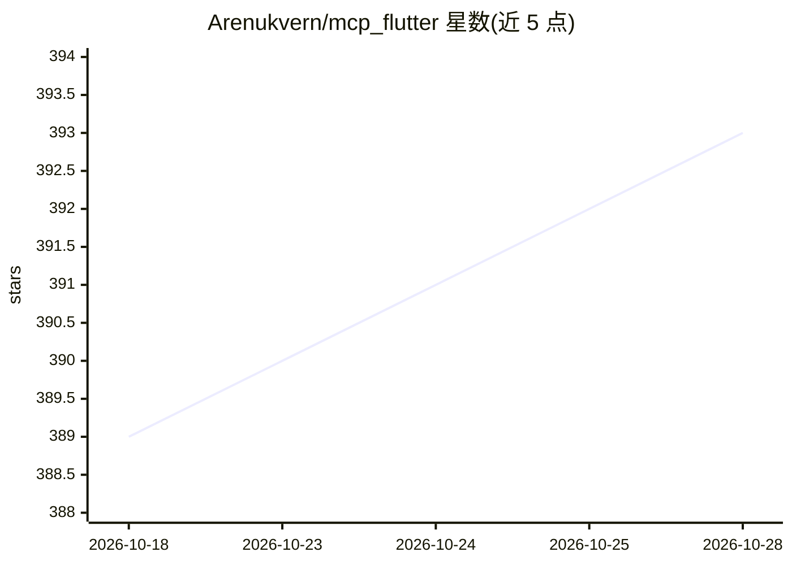

# Arenukvern/mcp_flutter

⭐ 394 · Dart · MIT · 推送 2026-10-17 · [GitHub](https://github.com/Arenukvern/mcp_flutter) · [官网](https://docs.page/arenukvern/mcp_flutter) · 个人维护

**让 AI agent 检查并驱动运行中 Flutter 应用的 MCP 工具集**

Dart 编写的 MCP 服务器加 Flutter 包，面向 Codex、Cursor、Claude Code 等 AI agent：agent 可对运行中的 Flutter 应用做语义快照、点击控件、填表单、热重载、读取日志，形成观察-操作-验证的闭环。应用可在运行时通过 mcp_toolkit 注册自定义 MCP 工具与资源。同一套词汇还延伸到 CLI（fmtk）、程序化 harness 包与 oka 生命周期运行器。要求应用以调试模式运行，Dump RPC 因 token 输出过大默认禁用。

## 筛选速览

| 维度 | 判定 | 备注 |
|---|---|---|
| AI 角色 | `ai-ecosystem` | LLM/agent 周边工具 |
| 许可风险 | `permissive` | MIT |
| 部署形态 | `library` | 以包/库形式分发 |
| 模型依赖 | locked-api |  |
| 硬件要求 | — | 无带数字的原话,不猜 |
| 安装摩擦 | `low` | 无编译、无系统依赖或容器化 |
| 成熟度 | — | 结构信号不足 |

## 能力要点

- 默认暴露 31 个 fmt_* 前缀 MCP 工具（检查/交互/调试/生命周期四类）
- Flutter 应用可在运行时动态注册自定义 MCP 工具与资源
- 同一 observe/act/verify 词汇覆盖 MCP、CLI、Dart harness、oka 四层
- 提供 OCI 镜像与 Claude Code/Codex/Cursor 等 agent 的安装配置

## 适用场景

- 让 Cursor/Claude Code 等 agent 在对话中直接调试和操作我的 Flutter 应用
- 在 CI 脚本中用 fmtk CLI 执行一次性 Flutter 应用操作命令
- 把业务功能暴露为自定义 MCP 工具供 agent 调用
- 用 Dart harness 包编写可入库的自动化验证场景

## 场景标签

`GUI 自动化` · 领域:效率与自动化

## 证据(README 行号)

> L25: `flutter-mcp-toolkit` is a Dart MCP server + Flutter package for AI agents (Codex, Zed, Cursor, Intent, Claude Code
> L27: And one step further: the toolkit is becoming a **chain of declarative automation APIs** — the same observe/act/ver

## 星数曲线

2026-10-18 389 → 2026-10-28 393（+4）

---
*卡片 v1 · prompt 1.4 · 生成 2026-10-21 · 置信度 mid · 依据 README sha `ab5695943686` · [字段定义](../../DATASET.md)*
