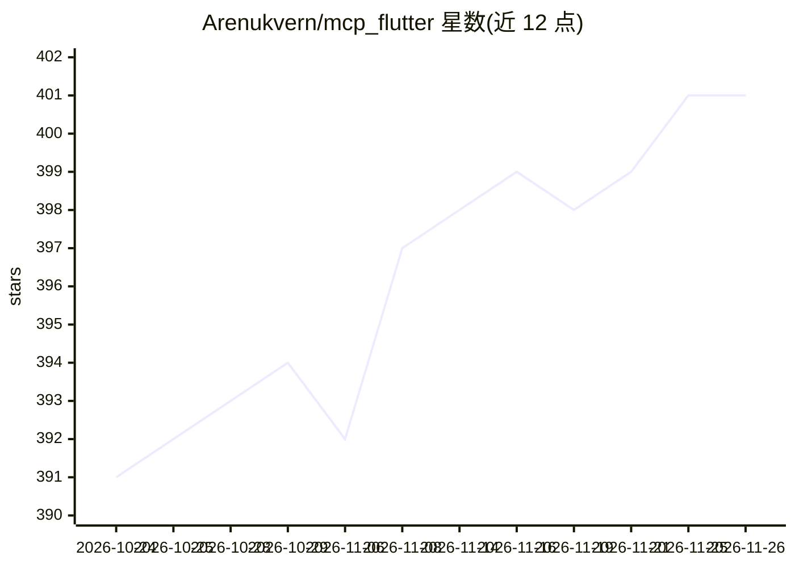

# Arenukvern/mcp_flutter

⭐ 401 · Dart · MIT · 推送 2026-11-25 · [GitHub](https://github.com/Arenukvern/mcp_flutter) · [官网](https://docs.page/arenukvern/mcp_flutter) · 个人维护

**让 AI 代理检查并驱动运行中 Flutter 应用的 MCP 工具包**

由 Dart MCP 服务器与 mcp_toolkit Flutter 包组成的开发工具链：代理可发现调试中的应用、读取语义 UI 快照、点击输入、热重载、截图，并调用应用在运行时注册的自定义工具，形成带运行时证明的闭环反馈。仅限 debug 模式使用，不支持 release 构建；服务器二进制支持 macOS Apple Silicon 与 Linux x64，不支持 Intel macOS。通过 Claude Code/Cursor/Codex 的插件市场或安装脚本分发。

## 筛选速览

| 维度 | 判定 | 备注 |
|---|---|---|
| AI 角色 | `ai-ecosystem` | LLM/agent 周边工具 |
| 许可风险 | `permissive` | MIT |
| 部署形态 | `None` |  |
| 模型依赖 | — | README 未给出锁定关系 |
| 硬件要求 | — | 无带数字的原话,不猜 |
| 安装摩擦 | `low` | 无编译、无系统依赖或容器化 |
| 成熟度 | `idea` | |

## 能力要点

- 代理可对运行中的调试应用执行发现、语义快照、点击输入、热重载与截图
- 应用可在运行时注册自定义 MCP 工具供代理调用
- 提供 flutter-mcp-toolkit doctor 验证与 fmt_* 能力接口
- 支持 Claude Code / Cursor / Codex 插件市场与 MCPB 安装包

## 适用场景

- 让 AI 助手读取并操作我正在调试的 Flutter 界面
- 在 Cursor 中用代理驱动 Flutter 应用并回读 UI 截图
- 在脚本或 CI 中以一次运行方式自动化 Flutter 调试流程

## 场景标签

`GUI 自动化` · 领域:效率与自动化

## 证据(README 行号)

> L28: **flutter-mcp-toolkit** is a Dart MCP server plus the `mcp_toolkit` Flutter package. An agent can discover your deb
> L57: |What is it?|MCP server (`flutter-mcp-toolkit-server`) + in-app `mcp_toolkit` bootstrap over the VM service.|
> L59: |When to use this vs Dart MCP?|**Dart MCP:** Dart/Flutter *tooling* (analyzer, tests). **This toolkit:** a *running

## 星数曲线

2026-10-24 391 → 2026-11-26 401（+10）

---
*卡片 v1 · prompt 1.4 · 生成 2026-11-26 · 置信度 high · 依据 README sha `b300d0572546` · [字段定义](../../DATASET.md)*
