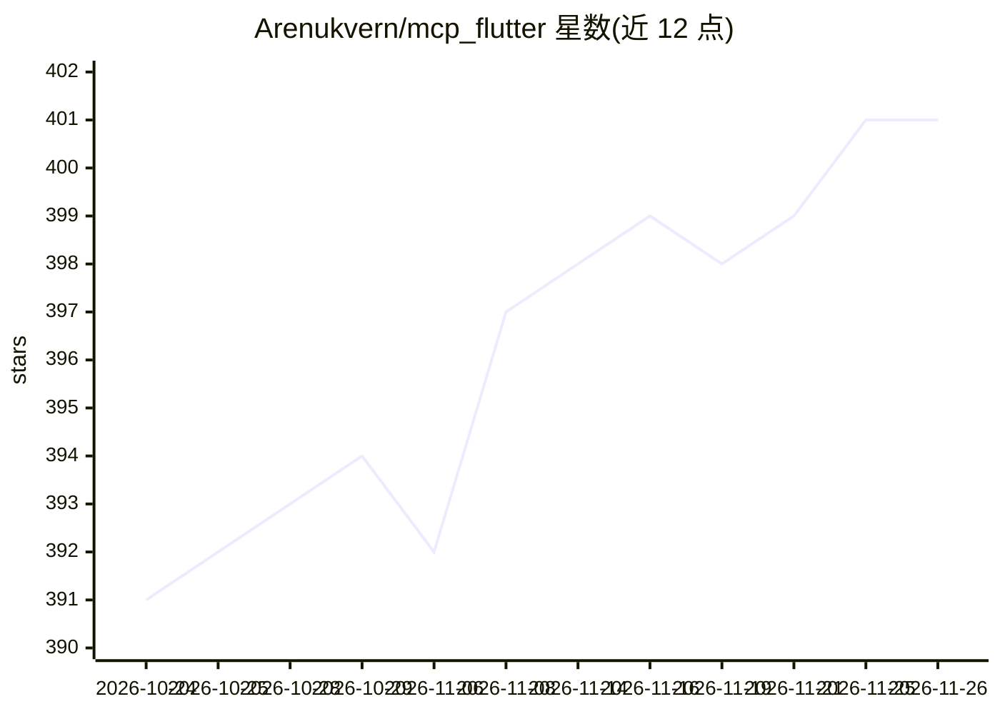

# Arenukvern/mcp_flutter

⭐ 401 · Dart · MIT · 推送 2026-11-25 · [GitHub](https://github.com/Arenukvern/mcp_flutter) · [官网](https://docs.page/arenukvern/mcp_flutter) · 个人维护

**让 AI 助手检查并驱动运行中 Flutter 应用的 MCP 工具包**

由 Dart MCP 服务器（flutter-mcp-toolkit-server）与应用内 mcp_toolkit 包组成，通过 VM service 连接调试中的 Flutter 应用：agent 可发现调试应用、读取语义化 UI 快照、点击与输入、热重载、截图，并调用应用在运行时注册的自定义工具，形成带运行时证据的闭环反馈。仅支持 debug 模式，不支持 release 构建；服务器二进制仅提供 macOS Apple Silicon 与 Linux x64，不支持 Intel macOS。

## 筛选速览

| 维度 | 判定 | 备注 |
|---|---|---|
| AI 角色 | `ai-ecosystem` | LLM/agent 周边工具 |
| 许可风险 | `permissive` | MIT |
| 部署形态 | `None` |  |
| 模型依赖 | — | README 未给出锁定关系 |
| 硬件要求 | — | 无带数字的原话,不猜 |
| 安装摩擦 | `low` | 无编译、无系统依赖或容器化 |
| 成熟度 | — | 结构信号不足 |

## 能力要点

- 语义化 UI 快照读取与点击/输入/滚动等 UI 驱动能力
- Flutter 渲染管线截图（fmt_get_screenshots）
- 应用运行时注册的自定义动态 MCP 工具
- 提供 Claude Code/Cursor/Codex 插件市场安装与 MCPB 打包

## 适用场景

- 让 AI 助手代为检查和操作运行中的 Flutter 调试应用
- 在 debug 循环中让 agent 修改代码后热重载并读取截图验证
- 为 Flutter 应用编写 E2E 场景与 CI 一次性脚本

## 场景标签

`编码 Agent` · 领域:编码与开发

## 证据(README 行号)

> L28: **flutter-mcp-toolkit** is a Dart MCP server plus the `mcp_toolkit` Flutter package. An agent can discover your deb
> L51: |What is it?|MCP server (`flutter-mcp-toolkit-server`) + in-app `mcp_toolkit` bootstrap over the VM service.|
> L54: |When not to use it?|Release builds, no debug VM, or you only need static analysis — use Dart MCP or CI instead.|

## 星数曲线

2026-10-24 391 → 2026-11-26 401（+10）

---
*卡片 v1 · prompt 1.4 · 生成 2026-11-25 · 置信度 high · 依据 README sha `2cedf4be35ba` · [字段定义](../../DATASET.md)*
