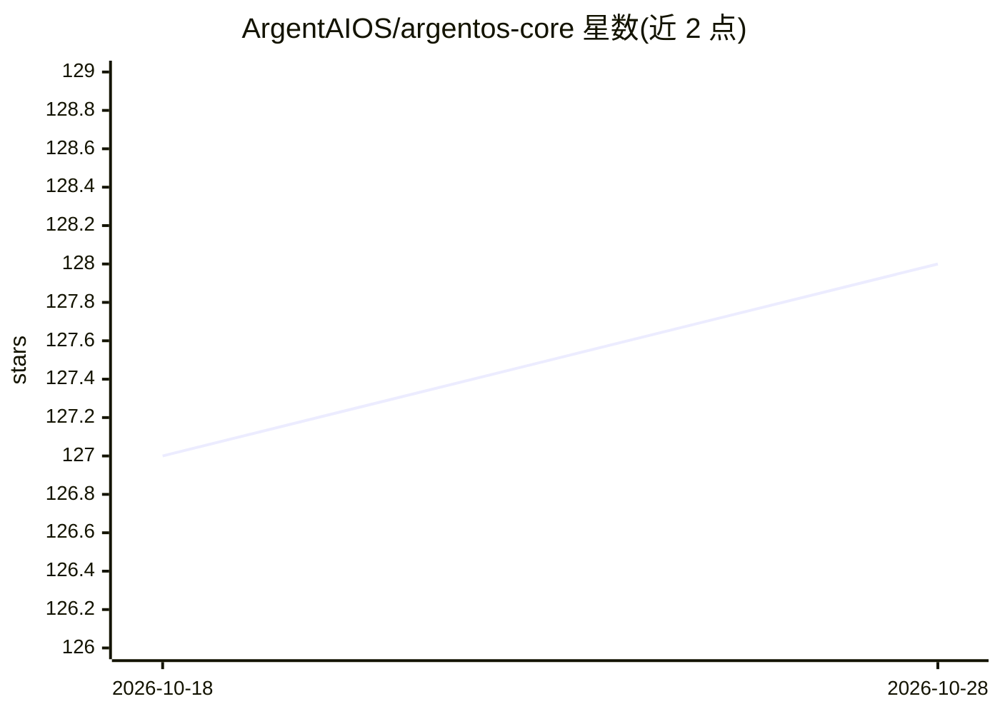

# ArgentAIOS/argentos-core

⭐ 128 · TypeScript · NOASSERTION · 推送 2026-07-09 · [GitHub](https://github.com/ArgentAIOS/argentos-core) · [官网](https://argentos.ai) · 组织维护

**自托管的个人 AI 操作系统：记忆、多渠道与自主代理**

运行在用户自有硬件上的个人 AI 操作系统，Core 为其免费开源基础层。包含 SQLite+pgvector 混合搜索记忆、常驻思考循环（可接 Ollama/LM Studio 本地模型）、Telegram/Discord/Slack 等多渠道接入、可视化多代理工作流、RAG 知识库、模型分级路由与自我改进系统等。安装依赖 Homebrew（macOS 优先），提供 curl 脚本与源码构建两种方式，技术栈为 Node/pnpm + PostgreSQL + Redis。

## 筛选速览

| 维度 | 判定 | 备注 |
|---|---|---|
| AI 角色 | `ai-ecosystem` | LLM/agent 周边工具 |
| 许可风险 | `none` | NOASSERTION |
| 部署形态 | `library` | 以包/库形式分发 |
| 模型依赖 | local-ok | 支持本地模型 |
| 硬件要求 | — | 无带数字的原话,不猜 |
| 安装摩擦 | `low` | 无编译、无系统依赖或容器化 |
| 成熟度 | — | 结构信号不足 |

## 能力要点

- SQLite+pgvector 混合搜索记忆与实体追踪
- 支持 Telegram/Discord/Slack/WhatsApp 等多渠道接入
- 可视化多代理工作流构建器（调度/审批/运行历史）
- 64 个连接器 harness 与本地模型（Ollama/LM Studio）思考循环

## 适用场景

- 在自己的硬件上运行一个长期记忆的个人 AI 助手
- 通过 Telegram/Discord 等聊天渠道与 AI 交互并自动执行任务
- 搭建带审批流程的多代理工作流与知识库问答

## 场景标签

`AI 助手` `Agent 记忆` `工作流自动化` `RAG` · 领域:Agent 开发

## 证据(README 行号)

> L17: ArgentOS is a personal AI operating system that runs on your hardware, speaks through your channels, remembers your
> L54: |**Contemplation**|Always-on thinking loop, local models via Ollama/LM Studio, episode journaling|

## 星数曲线

2026-10-18 127 → 2026-10-28 128（+1）

---
*卡片 v1 · prompt 1.4 · 生成 2026-10-23 · 置信度 mid · 依据 README sha `871911589919` · [字段定义](../../DATASET.md)*
