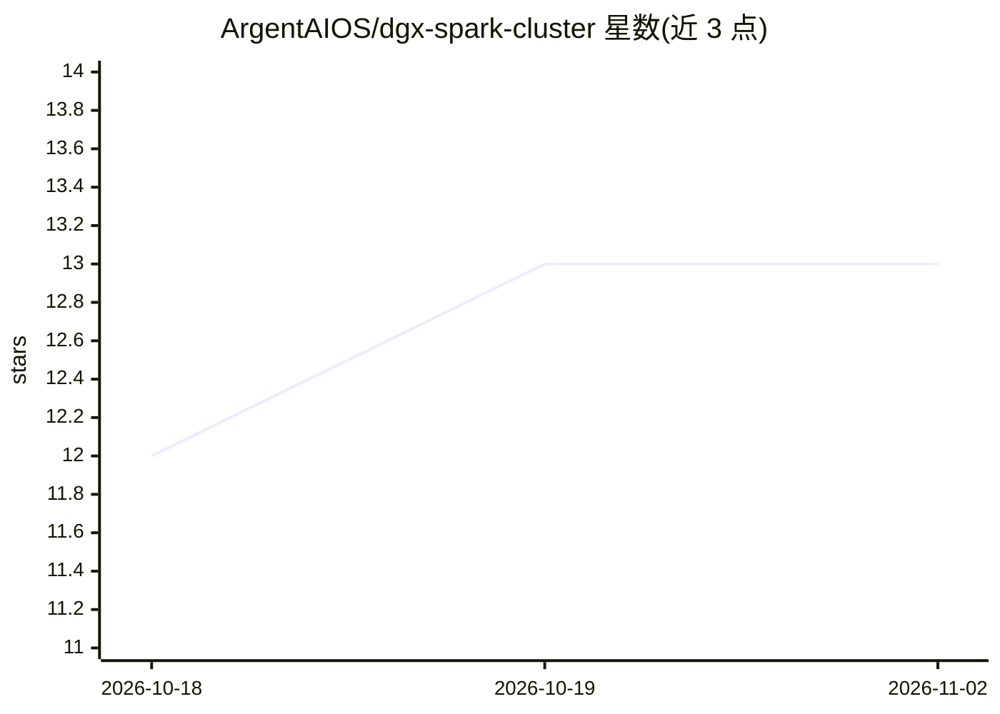

# ArgentAIOS/dgx-spark-cluster

⭐ 13 · Python · 推送 2026-04-11 · [GitHub](https://github.com/ArgentAIOS/dgx-spark-cluster) · 个人维护

**双节点 DGX Spark 集群的搭建与训练指南（配置+脚本+文档）**

面向 NVIDIA DGX Spark（Grace Blackwell GB10）双机集群的完整搭建指南仓库：覆盖 200 Gb/s 直连 RoCEv2 网络配置、NCCL 调优（safe 与 dmabuf 两模式，解决本硬件 GPU Direct RDMA 不可用导致的训练挂起）、DDP+LoRA 分布式训练流水线、Exo 跨节点模型分片推理、MikroTik ROSE NVMe-TCP 共享存储与监控运维文档。附 netplan/systemd/NCCL 配置文件与启动、验证脚本；限制为硬件特定，需 DGX Spark、CUDA 12.4+ 与 Mellanox OFED 24.07。

## 筛选速览

| 维度 | 判定 | 备注 |
|---|---|---|
| AI 角色 | `ai-knowledge` | 知识聚合/清单类 |
| 许可风险 | `none` | — |
| 部署形态 | `library` | 以包/库形式分发 |
| 模型依赖 | — | README 未给出锁定关系 |
| 硬件要求 | — | 无带数字的原话,不猜 |
| 安装摩擦 | `medium` | 含编译或系统依赖之一 |
| 成熟度 | — | 结构信号不足 |

## 能力要点

- 提供经测试的 NCCL 双模式配置，规避 GB10 不支持 GPU Direct RDMA 导致的 DDP 挂起
- 端到端训练流水线：数据准备→DDP LoRA 训练→评估→合并（实测 93.5% 扩展效率、1.87x 提速）
- Exo 双节点分片推理与 OpenAI 兼容 API，可服务单机 128GB 放不下的模型（如 Llama 405B）
- NVMe-TCP 共享存储与 3-10 节点扩展、监控、备份等运维文档

## 适用场景

- 我在 DGX Spark 双机上搭建分布式 LLM 微调环境并排查 NCCL 挂起问题
- 我需要跨两台机器分片运行超出单机内存的大模型推理
- 我想给集群接上 NVMe-TCP 共享数据集与模型权重存储

## 场景标签

`微调` `推理引擎` · 领域:训练与推理

## 证据(README 行号)

> L13: ## Guides
> L15: ### Getting Started
> L63: This repo provides the **tested, working configuration** for distributed PyTorch training on DGX Spark, including t

## 星数曲线

2026-10-18 12 → 2026-11-02 13（+1）

---
*卡片 v1 · prompt 1.4 · 生成 2026-10-31 · 置信度 mid · 依据 README sha `a382a2aa9dda` · [字段定义](../../DATASET.md)*
