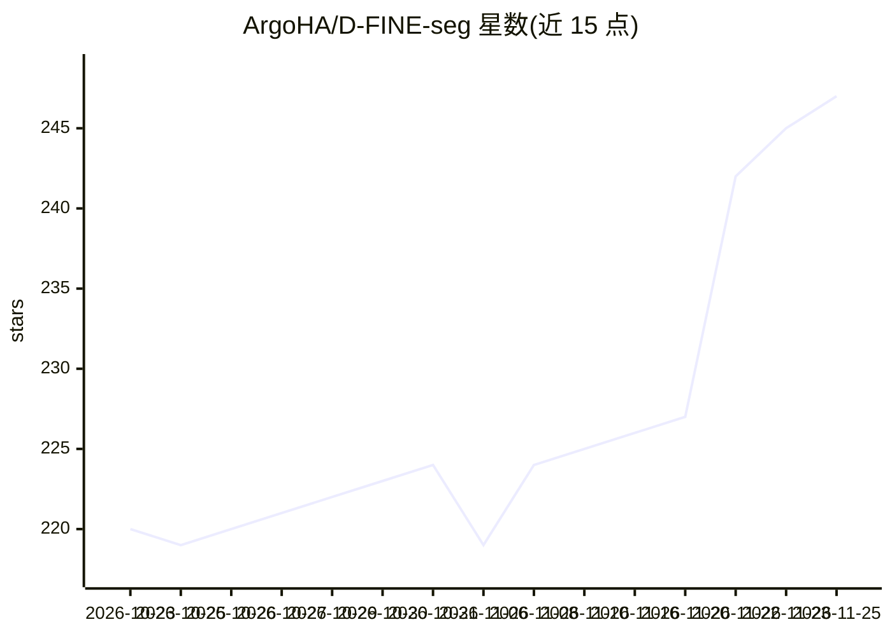

# ArgoHA/D-FINE-seg

⭐ 247 · Python · Apache-2.0 · 推送 2026-11-23 · [GitHub](https://github.com/ArgoHA/D-FINE-seg) · [官网](https://dfine-seg.argoai.space) · 组织维护

**面向视觉开发者的实时检测/分割/关键点统一训练部署框架**

一个实时视觉任务的 PyTorch 框架，通过一个配置项（task: detect | segment | sem_seg | kpts）覆盖目标检测、实例分割、语义分割与关键点估计，提供 N 到 X 五种模型规模。工作流覆盖数据准备（YOLO 与 COCO JSON 标注、PNG 语义掩码、4 通道 .npy 多模态输入）、训练（DDP、EMA、AMP、蒸馏）与导出（ONNX、TensorRT、OpenVINO、CoreML）。提供 C++ 动态库 libdfine.so 用于嵌入式部署，预训练权重首次使用时从 Hugging Face 自动下载。安装方式为 pip 或源码。

## 筛选速览

| 维度 | 判定 | 备注 |
|---|---|---|
| AI 角色 | `ai-native` | 本体是模型或模型工具 |
| 许可风险 | `permissive` | Apache-2.0 |
| 部署形态 | `library` | 以包/库形式分发 |
| 模型依赖 | — | README 未给出锁定关系 |
| 硬件要求 | — | 无带数字的原话,不猜 |
| 安装摩擦 | `medium` | 含编译或系统依赖之一 |
| 成熟度 | — | 结构信号不足 |

## 能力要点

- 一个配置项在检测/实例分割/语义分割/关键点四类任务间切换，五种模型规模
- 提供 ONNX、TensorRT、OpenVINO、CoreML 导出及多后端基准推理
- C++ 核心 libdfine.so：TensorRT 加融合 CUDA 前/后处理，面向机器人与 Jetson 板
- 支持 RGB+热成像/深度/NIR 的 4 通道输入训练与 SAM3 自动标注

## 适用场景

- 训练自己的检测、分割或姿态估计模型并导出到边缘设备
- 在机器人/Jetson 上用 C++ 库跑低延迟多任务视觉推理
- 用热成像或深度通道数据训练多模态检测模型

## 场景标签

`目标检测` `模型训练` · 领域:感知与多模态

## 证据(README 行号)

> L21: D-FINE-seg is a framework for real-time **object detection**, **keypoint estimation**, **instance** and **semantic 
> L53: pip install dfine-seg           # inference + training
> L43: - **C++ core** - `libdfine.so` for all four tasks: TensorRT plus fused CUDA pre/postprocessing, no dependencies bey

## 星数曲线

2026-10-23 220 → 2026-11-25 247（+27）

---
*卡片 v1 · prompt 1.4 · 生成 2026-11-25 · 置信度 high · 依据 README sha `2c13d15d01da` · [字段定义](../../DATASET.md)*
