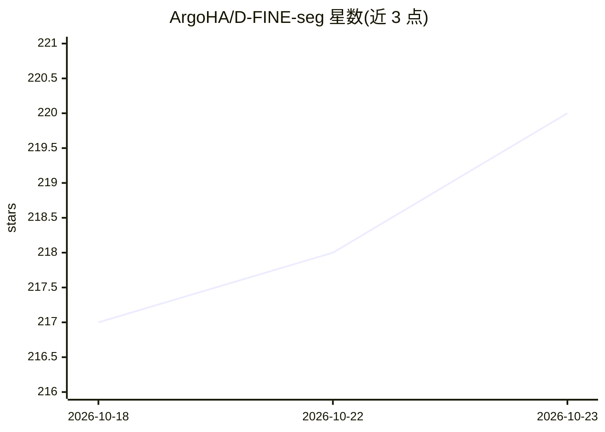

# ArgoHA/D-FINE-seg

⭐ 220 · Python · Apache-2.0 · 推送 2026-10-22 · [GitHub](https://github.com/ArgoHA/D-FINE-seg) · [官网](https://arxiv.org/abs/2602.23043) · 个人维护

**实时目标检测与实例/语义分割训练推理框架，面向开发者**

基于 D-FINE 检测核心（非 fork，分割部分从零实现）的端到端视觉框架：一个代码库通过 task 配置项支持目标检测、实例分割与语义分割三种任务，提供 N-X 五种模型规模。工作流覆盖数据准备（YOLO/COCO JSON/PNG mask 格式，支持 RGB+热成像等多通道输入）、训练（DDP、EMA、AMP、Muon 优化器、蒸馏）、导出（ONNX/TensorRT/OpenVINO/CoreML，含 INT8 量化）与多后端推理。预训练权重从 Hugging Face 自动下载，pip 安装即可两行代码预测。限制：基于 Cityscapes 权重微调的模型继承非商业条款。

## 筛选速览

| 维度 | 判定 | 备注 |
|---|---|---|
| AI 角色 | `ai-native` | 本体是模型或模型工具 |
| 许可风险 | `permissive` | Apache-2.0 |
| 部署形态 | `library` | 以包/库形式分发 |
| 模型依赖 | — | README 未给出锁定关系 |
| 硬件要求 | — | 无带数字的原话,不猜 |
| 安装摩擦 | `medium` | 含编译或系统依赖之一 |
| 成熟度 | — | 结构信号不足 |

## 能力要点

- 一个代码库、一个配置项切换检测/实例分割/语义分割三种任务
- 导出至 ONNX、TensorRT、OpenVINO、CoreML 并支持 INT8 量化
- 支持 RGB+thermal/depth/NIR 四通道输入训练
- 预训练权重首次使用时从 Hugging Face 自动下载

## 适用场景

- 在自有数据集上训练检测或分割模型并部署到边缘设备
- 用 COCO/Cityscapes 预训练权重直接做推理或微调
- 导出多后端模型并跑基准测试选择部署方案

## 场景标签

`目标检测` · 领域:感知与多模态

## 证据(README 行号)

> L20: D-FINE-seg is a framework for real-time **object detection**, **instance segmentation**, and **semantic segmentatio
> L22: - End-to-end workflow - dataset prep -> training (DDP, EMA, AMP, mosaic) -> export (ONNX, TensorRT, OpenVINO, CoreM
> L23: - Accuracy - Cityscapes semantic segmentation at native 1024x2048: D-FINE-seg-X reaches 84.84 mIoU at 14.6 ms end-t

## 星数曲线

2026-10-18 217 → 2026-10-23 220（+3）

---
*卡片 v1 · prompt 1.4 · 生成 2026-10-22 · 置信度 high · 依据 README sha `ff613c80581b` · [字段定义](../../DATASET.md)*
