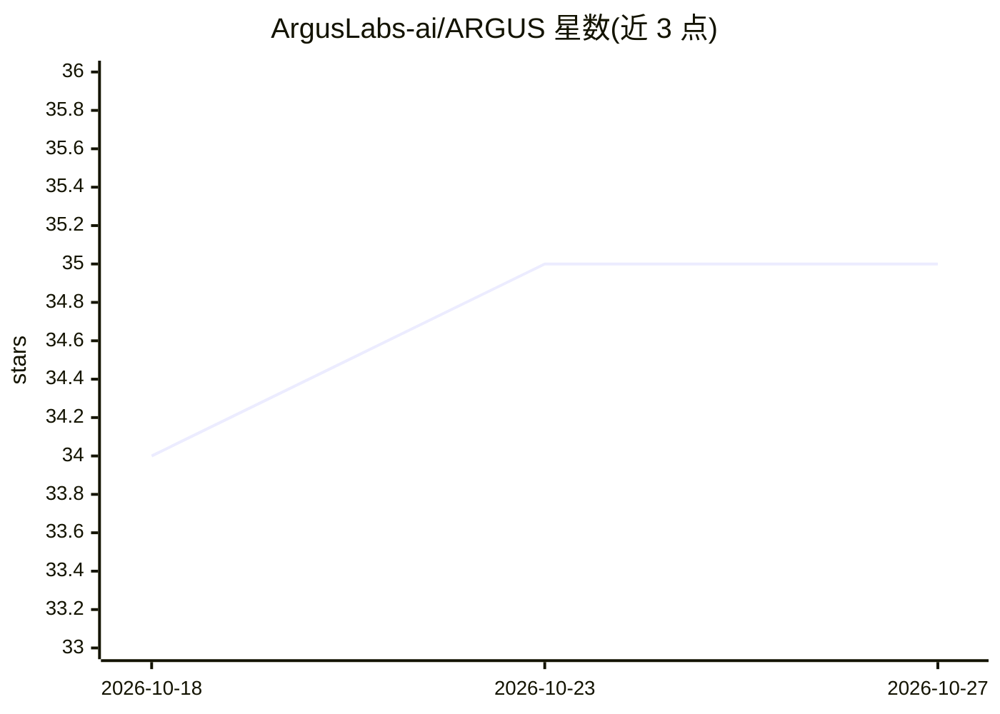

# ArgusLabs-ai/ARGUS

⭐ 35 · Python · NOASSERTION · 推送 2026-10-25 · [GitHub](https://github.com/ArgusLabs-ai/ARGUS) · [官网](https://www.arguslabs.in/) · 组织维护

**LangGraph 管道静默失败检测工具：定位问题真正发生的节点**

面向 LangGraph 开发者的管线调试与可观测工具：以 ArgusRecorder 挂载回调流记录每个节点的输出更新，捕捉空更新、字段被丢弃、工具失败等静默失败，并把责任定位到引发问题的节点而非后续崩溃节点。支持 consumers 声明字段读写契约、健康基线对比、CLI 检查与 UI；可选接入 BYOK（OpenAI/Anthropic/Google）启用 LLM 运行评审，无 key 时回退到纯启发式检测。遥测仅发送数据形状不发送值。项目自述处于 Beta 早期阶段。

## 筛选速览

| 维度 | 判定 | 备注 |
|---|---|---|
| AI 角色 | `ai-ecosystem` | LLM/agent 周边工具 |
| 许可风险 | `none` | NOASSERTION |
| 部署形态 | `library` | 以包/库形式分发 |
| 模型依赖 | locked-api |  |
| 硬件要求 | — | 无带数字的原话,不猜 |
| 安装摩擦 | `low` | 无编译、无系统依赖或容器化 |
| 成熟度 | `idea` | |

## 能力要点

- ArgusRecorder 挂载 LangGraph 回调流，不修改图与节点代码
- 捕捉静默失败（空更新/字段丢弃/工具失败）并归责到根因节点
- consumers= 声明字段级读写契约，支持嵌套路径、循环与子图
- BYOK 启用 LLM run reviewer，无 key 回退纯启发式

## 适用场景

- LangGraph 管道上生产前排查无异常但下游字段缺失的问题
- 声明字段契约，在 CI 中拦截节点悄悄丢字段
- 对比健康运行基线发现行为回归

## 场景标签

`LLM 可观测性` · 领域:评测与运维

## 证据(README 行号)

> L9: Your LangGraph pipeline runs fine — no exception. But three nodes later, something crashes with a `KeyError`. The re
> L35: app = ArgusRecorder().attach(graph)
> L39: rewritten — ARGUS rides LangGraph's own callback stream. See

## 星数曲线

2026-10-18 34 → 2026-10-27 35（+1）

---
*卡片 v1 · prompt 1.4 · 生成 2026-10-25 · 置信度 high · 依据 README sha `fbe22f9bf0a4` · [字段定义](../../DATASET.md)*
