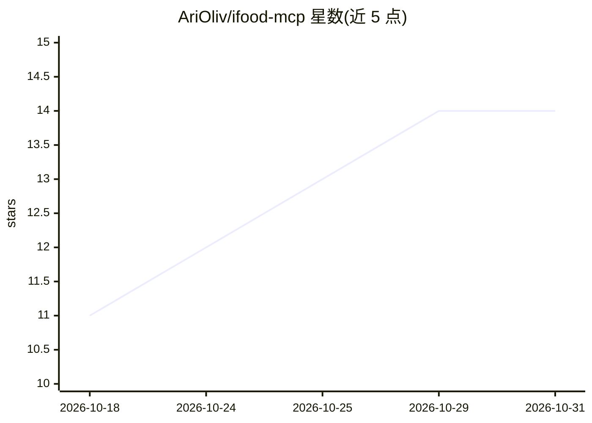

# AriOliv/ifood-mcp

⭐ 14 · TypeScript · MIT · 推送 2026-10-10 · [GitHub](https://github.com/AriOliv/ifood-mcp) · [官网](https://github.com/AriOliv/ifood-mcp) · 个人维护

**非官方 iFood MCP 服务器：让 AI 助手浏览搜索并下单外卖**

用 TypeScript 编写的非官方 Model Context Protocol 服务器，封装 iFood 消费者 Web API，向 Claude Code、Claude Desktop、Cursor、Codex 等 MCP 客户端暴露 25 个工具，覆盖餐厅搜索、菜单浏览、购物车管理、下单与订单历史等。提供两种传输：stdio（本地单用户，从浏览器 DevTools 粘贴令牌）与 HTTP + OAuth 2.1（真实 iFood OTP 登录页，支持多用户）。无状态传输、内存令牌存储、60 秒自动刷新；非官方性质，依赖未公开的站点接口，可能触发机器人检测。

## 筛选速览

| 维度 | 判定 | 备注 |
|---|---|---|
| AI 角色 | `ai-ecosystem` | LLM/agent 周边工具 |
| 许可风险 | `permissive` | MIT |
| 部署形态 | `library` | 以包/库形式分发 |
| 模型依赖 | — | README 未给出锁定关系 |
| 硬件要求 | — | 无带数字的原话,不猜 |
| 安装摩擦 | `low` | 无编译、无系统依赖或容器化 |
| 成熟度 | — | 结构信号不足 |

## 能力要点

- 25 个工具覆盖搜索、目录、购物车、下单、订单与钱包
- stdio 与 Streamable HTTP 两种传输模式可独立运行
- OAuth 2.1 + PKCE S256 的真实 iFood OTP 登录流程
- HTTP 模式下 iFood 令牌仅存内存，不落盘

## 适用场景

- 在 Claude/Cursor/Codex 中用自然语言点 iFood 外卖
- 让 AI 助手查看历史订单并一键复购
- 本地或远程部署供多用户共享的 iFood MCP 服务

## 场景标签

 · 领域:本地生活服务/AI 工具接入

## 证据(README 行号)

> L8: Unofficial Model Context Protocol server for iFood — Brazil's largest food delivery platform. Browse restaurants, se
> L14: This MCP server gives AI assistants (Claude Code, Claude Desktop, Cursor, Codex, etc.) access to your iFood account
> L26: |Mode|Transport|Login|Best for|

## 星数曲线

2026-10-18 11 → 2026-10-31 14（+3）

---
*卡片 v1 · prompt 1.4 · 生成 2026-10-31 · 置信度 high · 依据 README sha `8e62fde0dad9` · [字段定义](../../DATASET.md)*
