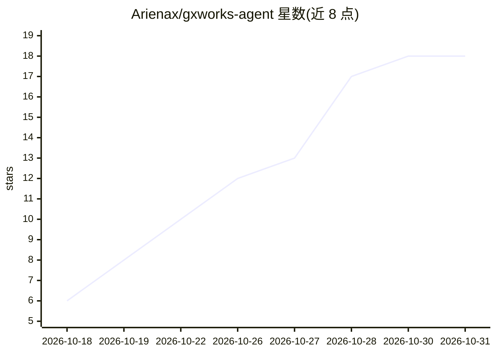

# Arienax/gxworks-agent

⭐ 18 · Python · Apache-2.0 · 推送 2026-10-29 · [GitHub](https://github.com/Arienax/gxworks-agent) · 个人维护 · 中文 README

**三菱 PLC 工程助手：MCP 工具链与 Web 工作台，读写 GX Works2 工程**

面向三菱 PLC（GX Works2）工程场景的 MCP 工具链与可选 Web 工作台。支持离线检查、编辑和保存 .gxw 文件而无需启动 GX Works2，覆盖 Ladder、ST、FBD 及既有 SFC 工程的受控编辑；通过 CPU 范围的工程 RAG（实体匹配+全文+稠密/LSA 检索与排序融合）检索指令事实，由 Python Core 做确定性校验并生成版本化工件（Ladder JSON、PLC IR、SVG、导入 CSV）。可接入 Codex、Claude Desktop、Cursor 等 MCP 客户端，也可在 Web 工作台配置模型 API 直接生成。原生会话需 Windows 交互桌面与 GX Works2 1.635.0.1。

## 筛选速览

| 维度 | 判定 | 备注 |
|---|---|---|
| AI 角色 | `ai-ecosystem` | LLM/agent 周边工具 |
| 许可风险 | `permissive` | Apache-2.0 |
| 部署形态 | `desktop` | 安装包/桌面程序 |
| 模型依赖 | — | README 未给出锁定关系 |
| 硬件要求 | — | 无带数字的原话,不猜 |
| 安装摩擦 | `low` | 无编译、无系统依赖或容器化 |
| 成熟度 | — | 结构信号不足 |

## 能力要点

- 离线检查/编辑/保存 .gxw，无需安装或启动 GX Works2
- CPU 范围工程 RAG：实体匹配+全文+稠密/LSA 检索与排序融合
- Ladder/ST/FBD/SFC 四语言共享离线事务，保存版本化工件（JSON/IR/SVG/CSV）
- 持久原生会话：单次 GX Works2 进程内多步编辑、会话内编译与地址查询

## 适用场景

- 用 Codex/Claude Desktop/Cursor 等 MCP 客户端规划、生成并核验 PLC 程序
- 离线修改已有 .gxw 工程的源、声明与注释并保存新版本
- 在 Web 工作台内分析需求、生成 Ladder/ST 并做可视化 diff 审查
- 在持续打开的 GX Works2 进程内完成多步编辑与会话内编译

## 场景标签

`代码生成` `RAG` · 领域:编码与开发

## 证据(README 行号)

> L7:  MCP engineering tools and an AI workbench for Mitsubishi PLC workflows.
> L24: Connect any MCP client—such as Codex, Claude Desktop, or Cursor—to use the engineering tools with your own model fo

## 星数曲线

2026-10-18 6 → 2026-10-31 18（+12）

---
*卡片 v1 · prompt 1.4 · 生成 2026-10-30 · 置信度 high · 依据 README sha `c4e1701f56ad` · [字段定义](../../DATASET.md)*
