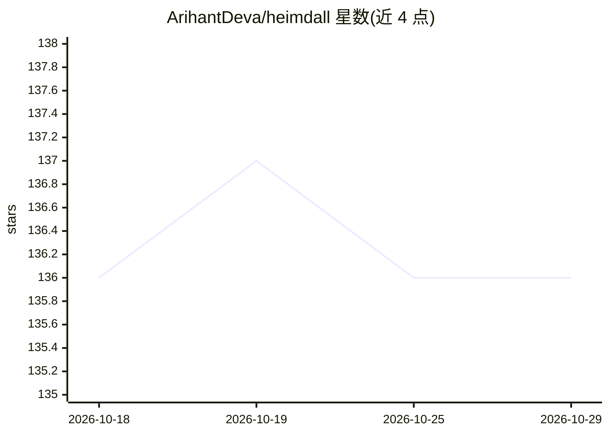

# ArihantDeva/heimdall

⭐ 136 · JavaScript · MIT · 推送 2026-10-27 · [GitHub](https://github.com/ArihantDeva/heimdall) · [官网](https://www.npmjs.com/package/@arihantdeva/heimdall) · 个人维护

**给 AI 编码代理的跨仓库持久记忆与已验证检索工具**

为 AI 编码代理提供跨所有仓库和项目的持久语义记忆：本地守护进程持续监听文件、tree-sitter AST 解析并计算本地嵌入，构建跨仓库语义图，索引过程零 LLM 调用、纯 CPU（可选用 GPU 提速）。检索为混合排序搜索（词法+语义+图遍历），并对每个结果做文件系统实时验证，标注 STRONG/WEAK/REBUILT/STALE。一条命令接入 pi、Claude Code、Codex、Cursor、Windsurf 等 harness，通过 MCP/CLI 使用。面向拥有大量侧项目的独立开发者，v0.2.0，基准评测仍在进行中。

## 筛选速览

| 维度 | 判定 | 备注 |
|---|---|---|
| AI 角色 | `ai-ecosystem` | LLM/agent 周边工具 |
| 许可风险 | `permissive` | MIT |
| 部署形态 | `library` | 以包/库形式分发 |
| 模型依赖 | — | README 未给出锁定关系 |
| 硬件要求 | `cpu-ok` | |
| 安装摩擦 | `high` | 编译与系统依赖俱全 |
| 成熟度 | `idea` | |

## 能力要点

- 跨仓库统一语义图记忆，跟随开发者跨项目与语言
- 索引纯本地 CPU（tree-sitter + bge-m3 本地嵌入），零 LLM 调用零 token 消耗
- 检索结果实时验证：STRONG/WEAK/REBUILT/STALE 四级判定
- 文件移动自动重锚（REBUILT），幂等重索引

## 适用场景

- 让编码代理直接回答'我是否在其他项目解决过这个问题'
- 新会话首条 prompt 注入相关历史工作，减少探索命令与 token 消耗
- 在多个 side project 间复用已积累的代码与知识

## 场景标签

`Agent 记忆` `语义搜索` · 领域:Agent 开发

## 证据(README 行号)

> L12: Heimdall gives AI coding agents **persistent memory across every repository and project you work on** so the questi
> L20: **3. Zero token spend.** Memory maintenance is a local daemon: file watching, tree-sitter AST parsing, sqlite. Inde
> L92: **Does it work with my agent?** One command wires it into pi, Claude Code, Codex, Cursor, or Windsurf. Anything tha

## 星数曲线

2026-10-18 136 → 2026-10-29 136（+0）

---
*卡片 v1 · prompt 1.4 · 生成 2026-10-22 · 置信度 mid · 依据 README sha `dfdb74fa46a1` · [字段定义](../../DATASET.md)*
