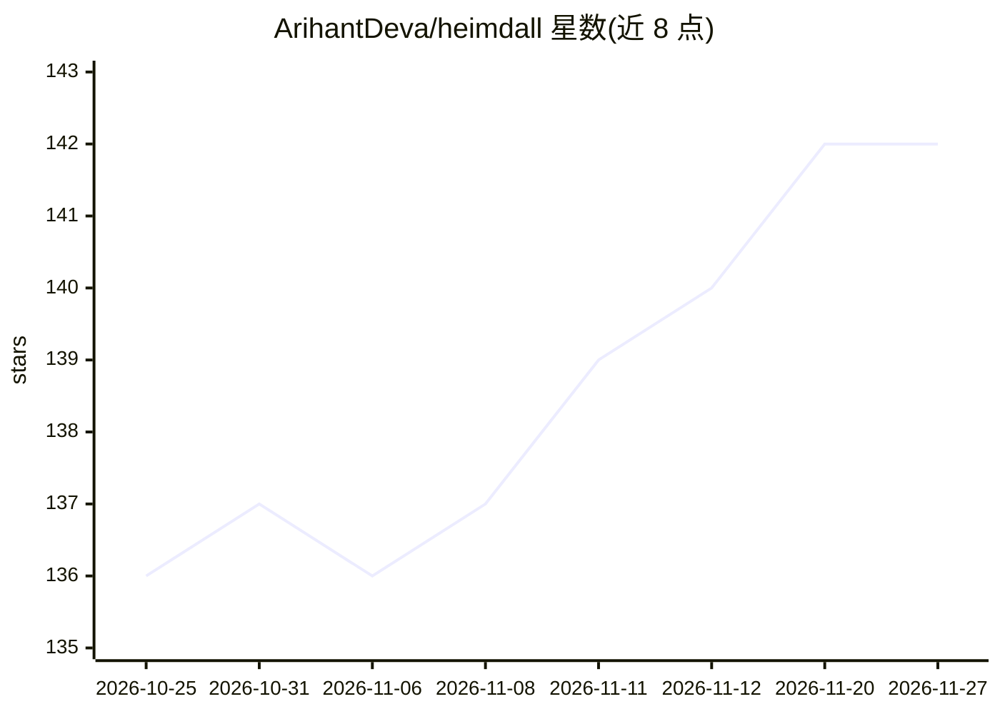

# ArihantDeva/heimdall

⭐ 142 · JavaScript · MIT · 推送 2026-11-02 · [GitHub](https://github.com/ArihantDeva/heimdall) · [官网](https://www.npmjs.com/package/@arihantdeva/heimdall) · 个人维护

**给 AI 编码代理提供跨仓库持久记忆与可验证检索**

Heimdall 是一个本地守护进程形式的代理记忆工具：用 tree-sitter 解析与本地 CPU embeddings（默认 bge-m3）将用户接触的所有仓库持续索引进单一语义图，索引过程不调用 LLM。检索为混合排序（词法+语义+图遍历），并对结果给出 STRONG/WEAK/REBUILT/STALE 等运行时验证判定。通过 npm 全局安装并自动构建 graft 后端，一条命令接入 pi、Claude Code、Codex、Cursor、Windsurf 等工具；可选 mnemosyne 作为替代检索后端。代码不离开本机，可选 Metal/CUDA 加速。

## 筛选速览

| 维度 | 判定 | 备注 |
|---|---|---|
| AI 角色 | `ai-ecosystem` | LLM/agent 周边工具 |
| 许可风险 | `permissive` | MIT |
| 部署形态 | `library` | 以包/库形式分发 |
| 模型依赖 | — | README 未给出锁定关系 |
| 硬件要求 | `cpu-ok` | |
| 安装摩擦 | `high` | 编译与系统依赖俱全 |
| 成熟度 | `idea` | |

## 能力要点

- 跨仓库语义图索引，文件监视+tree-sitter+本地 embeddings，索引零 LLM 调用
- 检索结果带 STRONG/WEAK/REBUILT/STALE 验证判定，移动文件自动重锚
- 一条命令接入 pi/Claude Code/Codex/Cursor/Windsurf，CLI search/insert 通用可用
- 可选 mnemosyne-oss 作为替代检索后端

## 适用场景

- 让编码代理在新会话中直接找到我在其他项目里解决过的类似问题
- 减少代理冷启动时的反复 grep/ls 探索与 token 消耗
- 在本地私有代码上做检索，数据不出机器

## 场景标签

`编码 Agent` `Agent 记忆` `RAG` `语义搜索` · 领域:Agent 开发

## 证据(README 行号)

> L12: Heimdall gives AI coding agents **persistent memory across every repository and project you work on** so the questi
> L18: **2. Orientation time, cut to seconds.** A fresh agent session burns dozens of bash commands just figuring out the 
> L92: **Does it work with my agent?** One command wires it into pi, Claude Code, Codex, Cursor, or Windsurf. Anything tha

## 星数曲线

2026-10-25 136 → 2026-11-27 142（+6）

---
*卡片 v1 · prompt 1.4 · 生成 2026-11-27 · 置信度 mid · 依据 README sha `7868ead2a3c0` · [字段定义](../../DATASET.md)*
