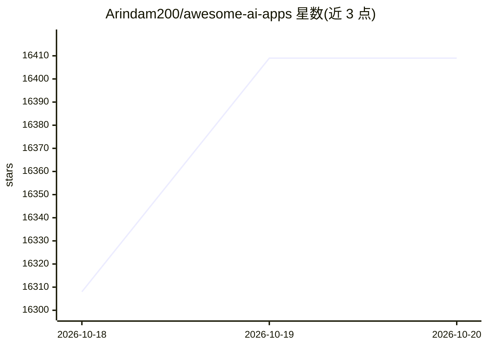

# Arindam200/awesome-ai-apps

⭐ 16,409 · Python · MIT · 推送 2026-10-09 · [GitHub](https://github.com/Arindam200/awesome-ai-apps) · [官网](https://dub.sh/nebius) · 个人维护

**面向开发者的 132 个 LLM 应用示例合集（agent/RAG/MCP/语音）**

收录 132 个项目、教程与配方的清单仓库，覆盖文本 agent、语音助手、RAG 应用与 MCP 工具等 LLM 应用类型，按 Starter Agents、Simple Agents、Voice Agents、MCP Agents、Memory Agents、RAG Applications 等类别组织，每个条目注明所用框架（AutoGen、LangChain/LangGraph、CrewAI、Agno、LlamaIndex、LiveKit、Pipecat 等）。面向学习各 AI 框架与技术栈的开发者，作为参考指南使用，多数示例由 Nebius Token Factory 等赞助方提供推理支持。

## 筛选速览

| 维度 | 判定 | 备注 |
|---|---|---|
| AI 角色 | `ai-knowledge` | 知识聚合/清单类 |
| 许可风险 | `permissive` | MIT |
| 部署形态 | `library` | 以包/库形式分发 |
| 模型依赖 | — | README 未给出锁定关系 |
| 硬件要求 | — | 无带数字的原话,不猜 |
| 安装摩擦 | `low` | 无编译、无系统依赖或容器化 |
| 成熟度 | — | 结构信号不足 |

## 动量与使用信号

- 维护:`active` — 距上次 push 8.6 天,年发版 0,36 位贡献者
- 涨星:近 1 天 **+95**(自 20261016 起算)
- 平台:— · 协议:MCP

## 能力要点

- 收录 132 个 LLM 应用示例项目，按 6+ 类别组织
- 覆盖 text agent、voice assistant、RAG、MCP 工具等类型
- 条目标明所用框架与技术栈，便于按框架检索
- 部分类别含多 agent、记忆与沙箱执行等进阶示例

## 适用场景

- 学习某个 AI 框架（LangGraph、CrewAI、Agno 等）的入门示例
- 为构建语音助手或 MCP 工具寻找参考实现
- 对比不同框架下同类 agent 应用的写法

## 场景标签

`教程课程` `精选清单` · 领域:学习与行业

## 证据(README 行号)

> L7: This repository is a comprehensive collection of **132 projects**, tutorials, and recipes for building powerful LLM-
> L119: **Quick-start agents for learning and extending different AI frameworks.** _21 projects_
> L184: **Examples using Model Context Protocol for external tool integration.** _14 projects_

## 星数曲线

2026-10-18 16,308 → 2026-10-20 16,409（+101）

---
*卡片 v1 · prompt 1.4 · 生成 2026-10-18 · 置信度 high · 依据 README sha `2e44ec1b9a69` · [字段定义](../../DATASET.md)*
