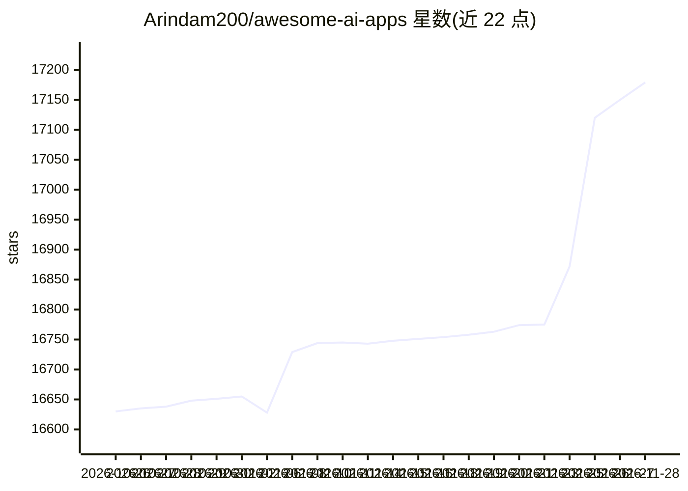

# Arindam200/awesome-ai-apps

⭐ 17,179 · Python · MIT · 推送 2026-11-27 · [GitHub](https://github.com/Arindam200/awesome-ai-apps) · [官网](https://studio1hq.com) · 个人维护

**LLM 应用与 Agent 示例项目合集（145 个可运行项目）**

面向构建 LLM 应用的开发者，收录 145 个可运行项目、教程与配方，覆盖文本 Agent、语音助手、RAG 应用、MCP 工具与微调流水线。按 8 个类别组织：入门 Agent、简单 Agent、语音 Agent、MCP Agent、记忆 Agent、RAG 应用、高级 Agent、微调。每个项目独立成目录，含各自 README、依赖清单与 .env.example，可克隆仓库后单独运行某一目录。MIT 许可，接受 PR 贡献。

## 筛选速览

| 维度 | 判定 | 备注 |
|---|---|---|
| AI 角色 | `ai-knowledge` | 知识聚合/清单类 |
| 许可风险 | `permissive` | MIT |
| 部署形态 | `None` |  |
| 模型依赖 | — | README 未给出锁定关系 |
| 硬件要求 | — | 无带数字的原话,不猜 |
| 安装摩擦 | `low` | 无编译、无系统依赖或容器化 |
| 成熟度 | — | 结构信号不足 |

## 动量与使用信号

- 维护:`active` — 距上次 push 8.6 天,年发版 0,36 位贡献者
- 涨星:近 1 天 **+95**(自 20261016 起算)
- 安装:github 包 `release-assets` 月下载无数据
- 平台:— · 协议:MCP

## 能力要点

- 145 个可运行项目，按 8 个类别分类（Starter/Simple/Voice/MCP/Memory/RAG/Advanced/Fine-Tuning）
- 每个项目独立目录，含 README、依赖与 .env.example
- 覆盖 Agno、LangGraph、CrewAI、OpenAI Agents SDK、Google ADK、Mastra 等框架的入门示例
- 含 LoRA 微调、蒸馏与开源模型部署类项目

## 适用场景

- 想找某个 Agent 框架的最小上手示例
- 为语音助手或 RAG 应用寻找可参考的实现
- 学习 MCP 服务器与外部工具集成模式
- 参考微调流水线部署开源模型

## 场景标签

`教程课程` · 领域:学习与行业

## 证据(README 行号)

> L5: **145 runnable LLM apps and agents, from 5-minute framework starters to production-grade multi-agent systems.**
> L18: Awesome AI Apps is a hands-on collection of projects, tutorials and recipes for building LLM-powered applications: 
> L91: |🧩 Starter Agents|One minimal agent per framework: Agno, LangGraph, CrewAI, OpenAI Agents SDK, Google ADK, Mastra a

## 星数曲线

2026-10-26 16,630 → 2026-11-28 17,179（+549）

---
*卡片 v1 · prompt 1.4 · 生成 2026-11-27 · 置信度 high · 依据 README sha `08e0c522a532` · [字段定义](../../DATASET.md)*
