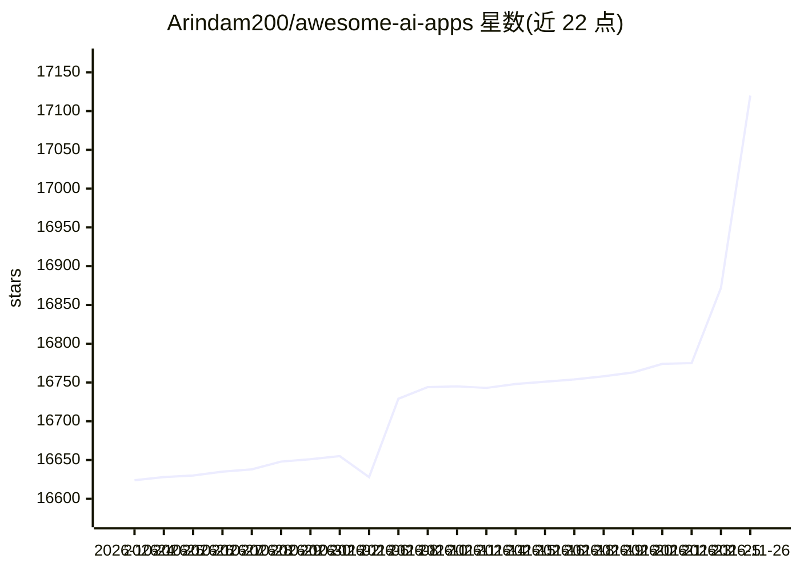

# Arindam200/awesome-ai-apps

⭐ 17,120 · Python · MIT · 推送 2026-11-16 · [GitHub](https://github.com/Arindam200/awesome-ai-apps) · [官网](https://studio1hq.com) · 个人维护

**LLM 应用与 Agent 示例项目合集：可克隆运行的 144 个项目**

面向学习与构建 LLM 应用开发者的实践项目合集，收录 144 个可运行项目，按 Starter/Simple Agents、Voice Agents、MCP Agents、Memory Agents、RAG 应用、Advanced Agents、Fine-Tuning 等类别组织，共 8 类。每个项目位于独立文件夹，含 README、依赖文件与 `.env.example`，克隆仓库后可单独运行。项目覆盖多家框架与提供商（Nebius、LiveKit、Pipecat、Deepgram、LangChain 等），采用 MIT 许可，接受 PR 贡献。

## 筛选速览

| 维度 | 判定 | 备注 |
|---|---|---|
| AI 角色 | `ai-knowledge` | 知识聚合/清单类 |
| 许可风险 | `permissive` | MIT |
| 部署形态 | `None` |  |
| 模型依赖 | — | README 未给出锁定关系 |
| 硬件要求 | — | 无带数字的原话,不猜 |
| 安装摩擦 | `low` | 无编译、无系统依赖或容器化 |
| 成熟度 | — | 结构信号不足 |

## 动量与使用信号

- 维护:`active` — 距上次 push 8.6 天,年发版 0,36 位贡献者
- 涨星:近 1 天 **+95**(自 20261016 起算)
- 安装:github 包 `release-assets` 月下载无数据
- 平台:— · 协议:MCP

## 能力要点

- 144 个可运行项目，覆盖 8 个类别（Starter Agents 22 个、Advanced Agents 41 个等）
- 每个项目独立文件夹，含 README、依赖与 .env.example
- 覆盖 RAG、语音 Agent、MCP 服务器、记忆 Agent、LoRA 微调等用例
- MIT 许可，接受社区 PR 贡献

## 适用场景

- 我想找一个具体框架（如 LangGraph、CrewAI）的最小可运行 Agent 示例
- 我想参考现成项目搭建语音客服或 RAG 问答应用
- 我想学习 MCP 服务器和外部工具集成的写法

## 场景标签

`精选清单` `教程课程` · 领域:学习与行业

## 证据(README 行号)

> L5: **144 runnable LLM apps and agents, from 5-minute framework starters to production-grade multi-agent systems.**
> L18: Awesome AI Apps is a hands-on collection of projects, tutorials and recipes for building LLM-powered applications: 
> L91: |🧩 Starter Agents|One minimal agent per framework: Agno, LangGraph, CrewAI, OpenAI Agents SDK, Google ADK, Mastra a

## 星数曲线

2026-10-24 16,624 → 2026-11-26 17,120（+496）

---
*卡片 v1 · prompt 1.4 · 生成 2026-11-22 · 置信度 high · 依据 README sha `282f57997352` · [字段定义](../../DATASET.md)*
