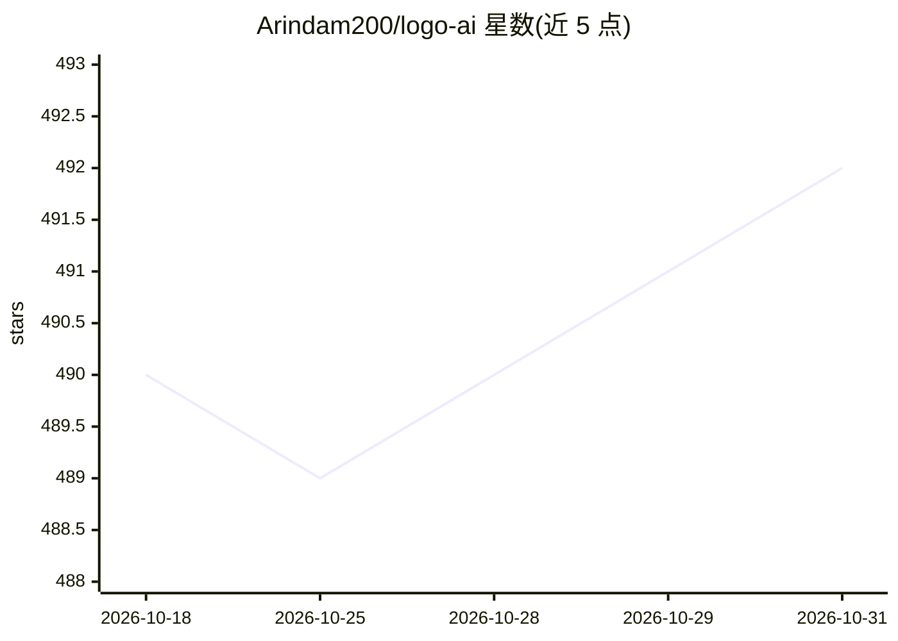

# Arindam200/logo-ai

⭐ 492 · TypeScript · NOASSERTION · 推送 2026-04-22 · [GitHub](https://github.com/Arindam200/logo-ai) · [官网](https://dub.sh/LogoAi) · 个人维护

**AI 驱动的 Logo 生成 Web 应用，基于 Nebius AI**

基于 Next.js/TypeScript 的全栈 Web 应用，调用 Nebius AI 的图像模型（FLUX、Stability AI SDXL）生成 Logo。提供 6 种风格预设、自定义颜色、三种尺寸（256/512/1024）与 Standard/HD 画质选项；含用户历史、公开画廊、Clerk 认证、每月 10 次生成限额（Upstash Redis）。需自备 NeonDB/Clerk/Nebius 等 API key，通过 git clone + npm 安装或 Docker Compose 部署，可部署到 Vercel。

## 筛选速览

| 维度 | 判定 | 备注 |
|---|---|---|
| AI 角色 | `ai-native` | 本体是模型或模型工具 |
| 许可风险 | `none` | NOASSERTION |
| 部署形态 | `self-host` | docker 或自建部署 |
| 模型依赖 | — | README 未给出锁定关系 |
| 硬件要求 | — | 无带数字的原话,不猜 |
| 安装摩擦 | `low` | 无编译、无系统依赖或容器化 |
| 成熟度 | — | 结构信号不足 |

## 能力要点

- 调用 Nebius AI 的 FLUX 与 Stability AI SDXL 模型生成 Logo
- 6 种风格预设、自定义颜色、3 种尺寸与 HD 画质选项
- 用户历史记录与公开画廊
- Clerk 认证 + Upstash Redis 限流（每月 10 次生成）

## 适用场景

- 为品牌或个人项目快速生成 Logo 草案
- 浏览他人生成的 Logo 获取灵感
- 作为 Next.js + AI 图像生成的参考项目自行部署

## 场景标签

`图像生成` · 领域:内容生成

## 证据(README 行号)

> L5: LogoAI is a modern web application that leverages artificial intelligence to generate unique, professional logos. Bu
> L10: - **Multiple AI Models**: Choose between different AI models including FLUX and Stability AI SDXL

## 星数曲线

2026-10-18 490 → 2026-10-31 492（+2）

---
*卡片 v1 · prompt 1.4 · 生成 2026-10-21 · 置信度 high · 依据 README sha `20e69587831a` · [字段定义](../../DATASET.md)*
