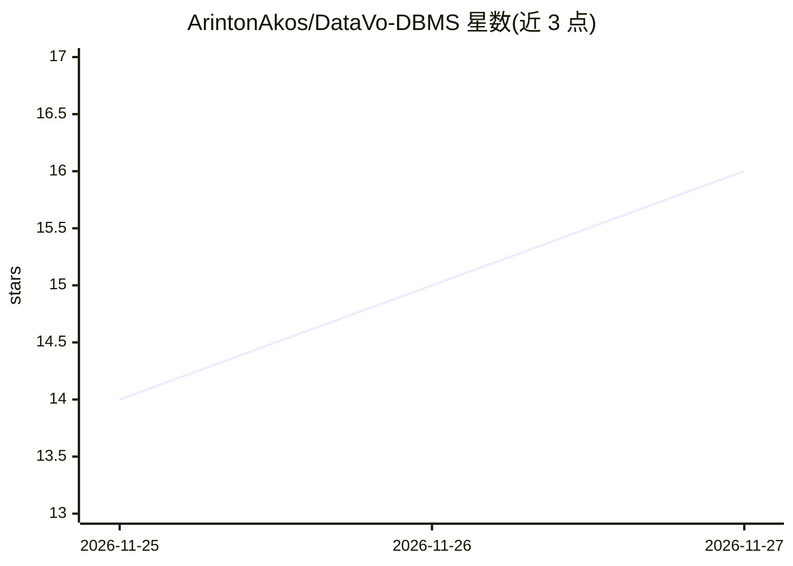

# ArintonAkos/DataVo-DBMS

⭐ 16 · C# · MIT · 推送 2026-11-26 · [GitHub](https://github.com/ArintonAkos/DataVo-DBMS) · [官网](https://arintonakos.github.io/DataVo-DBMS/) · 个人维护

**.NET 嵌入式数据库：进程内 SQL、LSM 存储、HNSW 向量搜索**

纯 C# 的 .NET 嵌入式数据库，无外部服务器、无原生二进制、支持 Native AOT。提供 InMemory 与 LSM 两种存储引擎（WAL+fsync 持久化）、SQL 与编译期 LINQ（Roslyn 源生成器）、列式索引、Z-set 增量维护的响应式视图，以及 VECTOR 列上的 FLAT/HNSW 向量搜索（余弦/欧氏距离）。通过 NuGet 分发四个包（Core/Data/Generators/EF Core 桥接），另有商业附加组件 DataVo Sync 提供 PostgreSQL 双向同步。当前为 prerelease，磁盘格式尚无跨版本兼容保证。

## 筛选速览

| 维度 | 判定 | 备注 |
|---|---|---|
| AI 角色 | `ai-enhanced` | 去掉 AI 部分产品仍成立 |
| 许可风险 | `permissive` | MIT |
| 部署形态 | `library` | 以包/库形式分发 |
| 模型依赖 | — | README 未给出锁定关系 |
| 硬件要求 | — | 无带数字的原话,不猜 |
| 安装摩擦 | `medium` | 含编译或系统依赖之一 |
| 成熟度 | `idea` | |

## 能力要点

- 进程内 SQL + 编译期 LINQ，无 P/Invoke 与原生二进制依赖
- VECTOR(n) 列支持 SIMD 加速的 FLAT 精确检索与 HNSW 索引，同一事务边界
- 列式分区索引实现零分配聚合，Z-set 增量视图按写维护多表 join
- 支持 Native AOT 干净发布，MIT 许可

## 适用场景

- 给 .NET 应用内嵌 SQL 持久化，无需部署数据库服务器
- 在同一嵌入式库内同时做关系查询与向量相似度搜索
- 对仪表盘类多表 join 查询做增量视图维护
- 需要 Native AOT 单文件发布的桌面/服务端 .NET 程序

## 场景标签

`向量数据库` · 领域:知识与检索

## 证据(README 行号)

> L8: **Pure C# embedded database for .NET 10** — in-process SQL, crash-safe LSM storage, columnar indexes, HNSW vector se
> L38: - **Built-in SQL + vector search:** Native `VECTOR(n)` columns with SIMD-accelerated `FLAT` (exact) and `HNSW` inde

## 星数曲线

2026-11-25 14 → 2026-11-27 16（+2）

---
*卡片 v1 · prompt 1.4 · 生成 2026-11-24 · 置信度 mid · 依据 README sha `fd955e15eb9b` · [字段定义](../../DATASET.md)*
