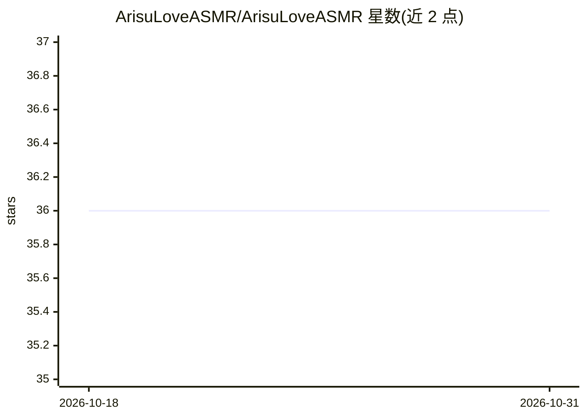

# ArisuLoveASMR/ArisuLoveASMR

⭐ 36 · Jupyter Notebook · GPL-3.0 · 推送 2026-08-11 · [GitHub](https://github.com/ArisuLoveASMR/ArisuLoveASMR) · 个人维护 · 中文 README

**Colab 笔记本：为 ASMR 音视频自动生成字幕并翻译成任意语言**

带图形界面的 Google Colab 笔记本，面向 ASMR 爱好者：用 WhisperX 多种模型（large-v3、distil-large-v3 等）识别语音，VAD 过滤与 Beam Search 可调，支持说话人分离并通过 Groq 自动命名说话人；输出 SRT/VTT/LRC 字幕。翻译支持 Google/DeepL/Gemini/Groq API 及 Qwen2.5、Dolphin 本地模型，可配风格指令与术语表。结果保存到 Google Drive；本地翻译模型在 Colab T4 上有 VRAM 不足风险。

## 筛选速览

| 维度 | 判定 | 备注 |
|---|---|---|
| AI 角色 | `ai-native` | 本体是模型或模型工具 |
| 许可风险 | `viral` | GPL-3.0 |
| 部署形态 | `None` |  |
| 模型依赖 | locked-api |  |
| 硬件要求 | — | 无带数字的原话,不猜 |
| 安装摩擦 | `low` | 无编译、无系统依赖或容器化 |
| 成熟度 | — | 结构信号不足 |

## 能力要点

- WhisperX 语音识别（多模型可选、VAD、说话人分离）
- Groq 自动为说话人命名并适配目标语言
- 7 种翻译后端（API 与本地模型），支持风格指令与术语表
- 批量处理文件与 Google Drive 文件夹，输出 SRT/VTT/LRC

## 适用场景

- 给 ASMR 音视频自动生成原文与翻译字幕
- 已有 srt/vtt/lrc 字幕直接翻译成目标语言
- 批量处理 Drive 中的多个音视频文件

## 场景标签

`语音识别` · 领域:感知与多模态

## 证据(README 行号)

> L16: - Автоматически распознавать речь в ASMR-аудио и видео
> L19: - Переводить на любой язык **без цензуры**

## 星数曲线

2026-10-18 36 → 2026-10-31 36（+0）

---
*卡片 v1 · prompt 1.4 · 生成 2026-10-25 · 置信度 high · 依据 README sha `249872b0adb7` · [字段定义](../../DATASET.md)*
