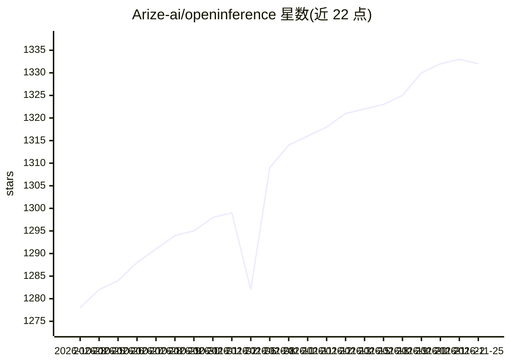

# Arize-ai/openinference

⭐ 1,332 · Python · Apache-2.0 · 推送 2026-11-23 · [GitHub](https://github.com/Arize-ai/openinference) · [官网](http://openinf.dev/) · 组织维护

**为 AI 应用提供 OpenTelemetry 追踪的插桩规范与库集合**

基于 OpenTelemetry 构建的 AI 可观测性项目：定义规范（specification）规定 LLM 调用、agent、工具、检索与嵌入在 trace 中的 span 类型与属性，并生成机器可读的 schema registry。按规范提供 Python、JavaScript、Java、Go 四种语言的插桩库，自动追踪主流模型 SDK 与 agent 框架的调用过程；另提供 Span Processor 统一 OpenLIT、OpenLLMetry 等其他插桩库的数据。轨迹可被 Arize Phoenix、Arize AX 及任意兼容 OpenTelemetry 的后端读取。

## 筛选速览

| 维度 | 判定 | 备注 |
|---|---|---|
| AI 角色 | `ai-ecosystem` | LLM/agent 周边工具 |
| 许可风险 | `permissive` | Apache-2.0 |
| 部署形态 | `library` | 以包/库形式分发 |
| 模型依赖 | local-ok | 支持本地模型 |
| 硬件要求 | — | 无带数字的原话,不猜 |
| 安装摩擦 | `low` | 无编译、无系统依赖或容器化 |
| 成熟度 | — | 结构信号不足 |

## 能力要点

- OpenInference 规范定义 LLM/agent/工具/检索 span 与属性约定，并以 schema registry 形式版本化发布
- 提供 Python、JavaScript、Java、Go 四语言的插桩库，覆盖数十个模型 SDK 与 agent 框架
- 原生支持 Arize Phoenix 与 Arize AX，兼容任意 OpenTelemetry 后端
- 提供 Span Processor 归一 OpenLIT 与 OpenLLMetry (Traceloop) 的 trace 数据

## 适用场景

- 为 LLM 应用加入分布式追踪，记录每次模型调用、工具使用与检索步骤
- 统一不同框架产生的 trace 格式，便于跨框架对比分析
- 将 agent 应用的调用链路接入现有 OpenTelemetry 观测后端

## 场景标签

`LLM 可观测性` · 领域:评测与运维

## 证据(README 行号)

> L9: OpenInference builds on OpenTelemetry to trace AI agents: their LLM calls, tool use,
> L27: Instrumentation libraries trace popular model providers and agent frameworks automatically, following the
> L28: specification. They are available for Python, JavaScript, Java and Go.

## 星数曲线

2026-10-23 1,278 → 2026-11-25 1,332（+54）

---
*卡片 v1 · prompt 1.4 · 生成 2026-11-23 · 置信度 high · 依据 README sha `35c4c67c19cb` · [字段定义](../../DATASET.md)*
