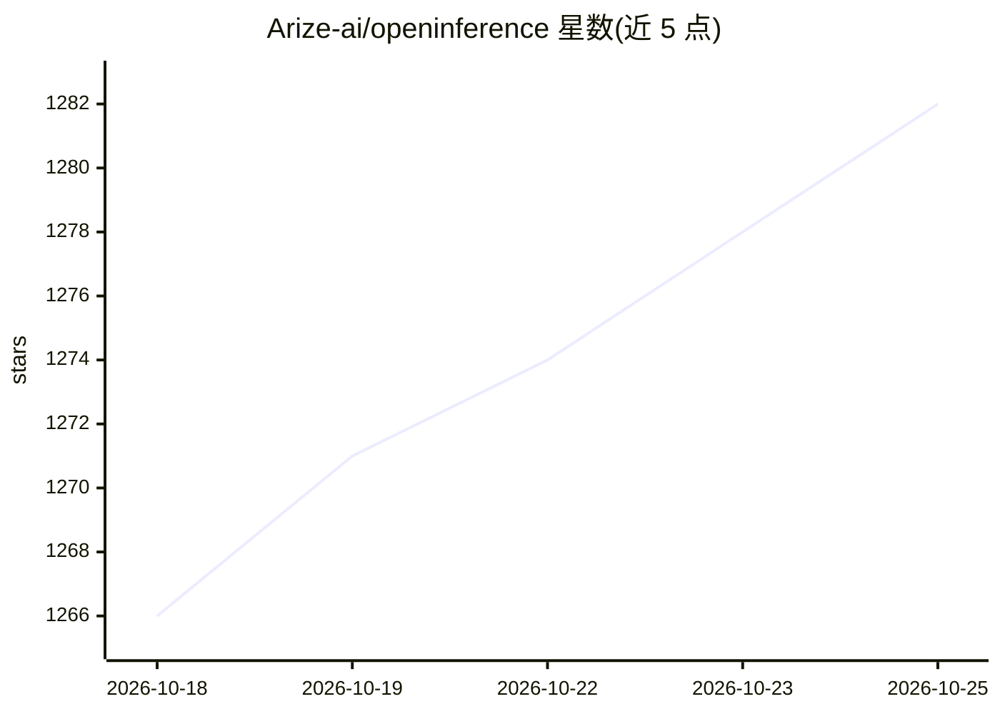

# Arize-ai/openinference

⭐ 1,284 · Python · Apache-2.0 · 推送 2026-10-24 · [GitHub](https://github.com/Arize-ai/openinference) · [官网](https://arize-ai.github.io/openinference/) · 组织维护

**为 AI 应用提供 OpenTelemetry 兼容追踪规范的插桩库集合**

OpenInference 提供一套与 OpenTelemetry 互补的约定（规范）和插桩插件，用于对 AI 应用进行追踪：记录 LLM 调用、向量检索、外部工具使用等上下文。规范以 markdown 编辑，传输与文件格式无关。以 Python/JavaScript/Java/Go 多语言库形式提供，覆盖 OpenAI、LangChain、LlamaIndex、Ollama 等数十个 SDK 与框架的专用插桩，以及 Span Processor 跨库数据统一；由 Arize 维护，原生支持 Arize Phoenix/AX 后端，也可用于任何 OpenTelemetry 兼容后端。

## 筛选速览

| 维度 | 判定 | 备注 |
|---|---|---|
| AI 角色 | `ai-ecosystem` | LLM/agent 周边工具 |
| 许可风险 | `permissive` | Apache-2.0 |
| 部署形态 | `library` | 以包/库形式分发 |
| 模型依赖 | local-ok | 支持本地模型 |
| 硬件要求 | — | 无带数字的原话,不猜 |
| 安装摩擦 | `low` | 无编译、无系统依赖或容器化 |
| 成熟度 | — | 结构信号不足 |

## 能力要点

- 提供与 OpenTelemetry 互补的 AI 追踪规范，传输与文件格式无关
- 数十个 SDK/框架的专用插桩包（OpenAI、LangChain、LlamaIndex、Bedrock、Ollama 等）
- 支持 Python/JavaScript/Java/Go 多语言发布（PyPI/npm/Maven）
- Span Processor 用于统一 OpenLIT、OpenLLMetry 等其他插桩库的数据

## 适用场景

- 为我的 LLM 应用接入 OpenTelemetry 追踪
- 将 LangChain/LlamaIndex 等框架的调用链路发送到 Phoenix 等可观测后端
- 统一多个追踪插桩库产生的 span 数据

## 场景标签

`LLM 可观测性` · 领域:评测与运维

## 证据(README 行号)

> L12: OpenInference is a set of conventions and plugins that is complementary to OpenTelemetry to
> L13: enable tracing of AI applications. OpenInference is natively supported
> L26: OpenInference provides a set of instrumentations for popular machine learning SDKs and frameworks in a variety of
> L27: languages.

## 星数曲线

2026-10-18 1,266 → 2026-10-25 1,282（+16）

---
*卡片 v1 · prompt 1.4 · 生成 2026-10-21 · 置信度 high · 依据 README sha `72086d534dbf` · [字段定义](../../DATASET.md)*
