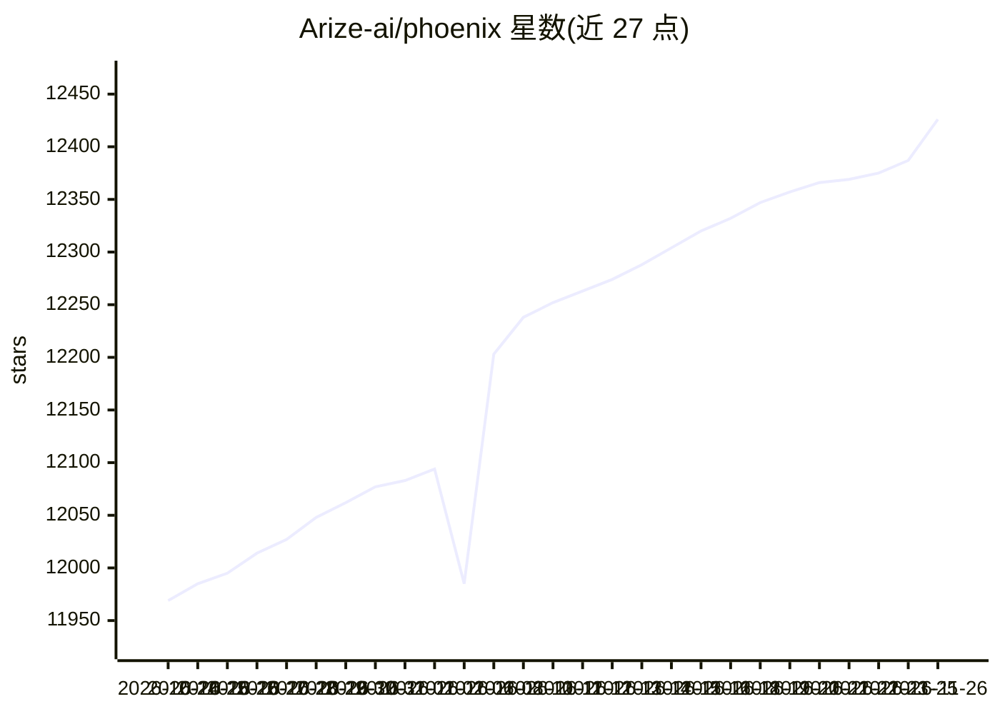

# Arize-ai/phoenix

⭐ 12,426 · Python · NOASSERTION · 推送 2026-11-25 · [GitHub](https://github.com/Arize-ai/phoenix) · [官网](https://arize.com/docs/phoenix) · 组织维护

**LLM 应用开发者用的开源 AI 可观测与评测平台**

Arize 开源的自托管 AI 可观测平台，围绕实验、评测与排障提供：基于 OpenTelemetry 的运行时追踪、用 LLM 做响应与检索评测、版本化数据集、prompt/模型/检索变更的实验追踪、prompt playground、prompt 版本管理、内置 PXI 调试 agent，以及供 Claude Code、Cursor 等 MCP 客户端接入的远程 MCP server。平台与厂商和语言无关，通过 OpenInference 提供数十个框架与 LLM 供应商的自动插桩包；可 pip/conda 本地运行，也可用 Docker/Helm 部署。

## 筛选速览

| 维度 | 判定 | 备注 |
|---|---|---|
| AI 角色 | `ai-ecosystem` | LLM/agent 周边工具 |
| 许可风险 | `none` | NOASSERTION |
| 部署形态 | `self-host` | docker 或自建部署 |
| 模型依赖 | local-ok | 支持本地模型 |
| 硬件要求 | — | 无带数字的原话,不猜 |
| 安装摩擦 | `low` | 无编译、无系统依赖或容器化 |
| 成熟度 | — | 结构信号不足 |

## 能力要点

- 基于 OpenTelemetry 的 LLM 应用运行时追踪，提供 40+ 框架/供应商自动插桩包
- LLM 评测工具链（RAG 相关性、回答相关性等）与版本化数据集、实验追踪
- Prompt 管理与 Playground：版本控制、参数调整、重放已追踪调用
- 内置 PXI agent 与远程 MCP server，可从 Claude Code/Cursor 查询追踪与数据集

## 适用场景

- 追踪和排查 LLM/agent 应用的线上调用链
- 对 RAG 应用的检索与回答质量做批量评测
- 系统化管理 prompt 版本并对比不同模型与参数
- 自托管团队收集和查询 OpenTelemetry 格式的 LLM 追踪数据

## 场景标签

`LLM 可观测性` `模型评测` `提示工程` · 领域:Agent 开发

## 证据(README 行号)

> L49: Arize Phoenix is Arize's open-source AI observability platform designed for experimentation, evaluation, and troubl
> L51: - **_Tracing_** - Trace your LLM application's runtime using OpenTelemetry-based instrumentation.
> L62: Phoenix is vendor and language agnostic with out-of-the-box support for popular frameworks (OpenAI Agents SDK, Clau

## 星数曲线

2026-10-24 11,969 → 2026-11-26 12,426（+457）

---
*卡片 v1 · prompt 1.4 · 生成 2026-11-26 · 置信度 high · 依据 README sha `4671a89ee48d` · [字段定义](../../DATASET.md)*
