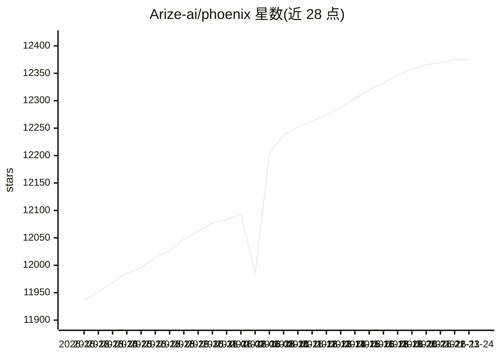

# Arize-ai/phoenix

⭐ 12,375 · Python · NOASSERTION · 推送 2026-11-22 · [GitHub](https://github.com/Arize-ai/phoenix) · [官网](https://arize.com/docs/phoenix) · 组织维护

**面向 LLM 应用的开源可观测与评估平台：追踪、评估、实验**

Arize 开源的 AI 可观测平台，功能覆盖基于 OpenTelemetry 的运行时追踪、利用 LLM 对响应与检索做评估、版本化数据集与实验管理、prompt 管理、playground 调试，以及内置的 PXI 调试 agent 与远程 MCP 服务端。平台与供应商、语言无关，通过 OpenInference 提供大量 Python/TypeScript 框架与 LLM 提供商的自动埋点包。可通过 pip/conda/uvx 本地运行，也可用 Docker/Helm 部署；托管版本为 Arize AX。

## 筛选速览

| 维度 | 判定 | 备注 |
|---|---|---|
| AI 角色 | `ai-ecosystem` | LLM/agent 周边工具 |
| 许可风险 | `none` | NOASSERTION |
| 部署形态 | `self-host` | docker 或自建部署 |
| 模型依赖 | local-ok | 支持本地模型 |
| 硬件要求 | — | 无带数字的原话,不猜 |
| 安装摩擦 | `low` | 无编译、无系统依赖或容器化 |
| 成熟度 | — | 结构信号不足 |

## 能力要点

- 基于 OpenTelemetry 的 LLM 应用运行时追踪（OpenInference 自动埋点）
- LLM 评估工具链（响应/检索相关性等，含 Python 与 TypeScript evals 包）
- 版本化数据集、实验追踪与 prompt 版本管理
- 远程 MCP 服务端与 phoenix-cli，可对接 Claude Code、Cursor 等编码 agent

## 适用场景

- 排查 LLM/agent 应用运行时的调用链路
- 对 prompt、模型、检索变更做实验与评估
- 自托管收集与查询应用追踪数据
- 通过 MCP 让编码 agent 查询 Phoenix 的追踪与数据集

## 场景标签

`LLM 可观测性` `模型评测` · 领域:评测与运维

## 证据(README 行号)

> L49: Arize Phoenix is Arize's open-source AI observability platform designed for experimentation, evaluation, and troubl
> L62: Phoenix is vendor and language agnostic with out-of-the-box support for popular frameworks (OpenAI Agents SDK, Clau
> L139: Phoenix is built on top of OpenTelemetry and is vendor, language, and framework agnostic. For details about tracin

## 星数曲线

2026-10-22 11,936 → 2026-11-24 12,375（+439）

---
*卡片 v1 · prompt 1.4 · 生成 2026-11-23 · 置信度 high · 依据 README sha `0d0bda32a749` · [字段定义](../../DATASET.md)*
