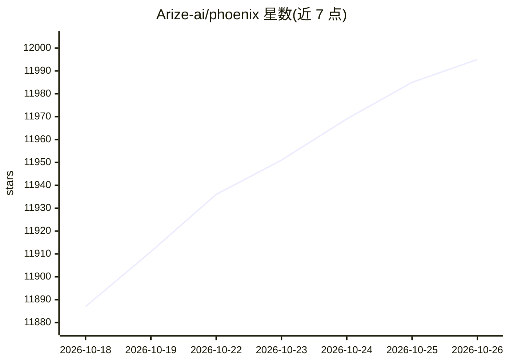

# Arize-ai/phoenix

⭐ 11,995 · Python · NOASSERTION · 推送 2026-10-25 · [GitHub](https://github.com/Arize-ai/phoenix) · [官网](https://arize.com/docs/phoenix) · 组织维护

**面向 LLM 应用的开源可观测性与评测平台**

Arize 维护的开源 AI 可观测性平台：基于 OpenTelemetry/OpenInference 对 LLM 应用做运行时追踪，提供 LLM 评测（响应与检索 evals）、版本化数据集、实验跟踪、Prompt 管理与 Playground，内置 AI 工程 agent PXI 和远程 MCP Server。厂商与语言无关，支持 OpenAI、Anthropic、Bedrock、Ollama 等多种 LLM 提供方及 LangChain、LlamaIndex 等框架的插桩集成。pip/conda 安装即可本地运行，另有 Docker/Helm 部署路径；托管版为商业产品 Arize AX。

## 筛选速览

| 维度 | 判定 | 备注 |
|---|---|---|
| AI 角色 | `ai-ecosystem` | LLM/agent 周边工具 |
| 许可风险 | `none` | NOASSERTION |
| 部署形态 | `self-host` | docker 或自建部署 |
| 模型依赖 | local-ok | 支持本地模型 |
| 硬件要求 | — | 无带数字的原话,不猜 |
| 安装摩擦 | `low` | 无编译、无系统依赖或容器化 |
| 成熟度 | `idea` | |

## 能力要点

- OpenTelemetry/OpenInference 基础的 LLM 应用追踪
- LLM 评测（RAG 相关性、回答相关性等）与版本化数据集、实验跟踪
- Prompt 版本管理与 Playground（调优、模型对比、回放）
- 内置 PXI agent 与远程 MCP Server，可接 Claude Code、Cursor 等客户端

## 适用场景

- 追踪和调试 LLM 应用的运行时调用链
- 对 RAG / Agent 应用做评测与实验对比
- 团队系统化管理 Prompt 变更与数据集

## 场景标签

`LLM 可观测性` `模型评测` `提示工程` · 领域:Agent 开发

## 证据(README 行号)

> L42: Arize Phoenix is Arize's open-source AI observability platform designed for experimentation, evaluation, and troubl
> L44: - **_Tracing_** - Trace your LLM application's runtime using OpenTelemetry-based instrumentation.
> L55: Phoenix is vendor and language agnostic with out-of-the-box support for popular frameworks (OpenAI Agents SDK, Clau

## 星数曲线

2026-10-18 11,887 → 2026-10-26 11,995（+108）

---
*卡片 v1 · prompt 1.4 · 生成 2026-10-20 · 置信度 high · 依据 README sha `4885975081de` · [字段定义](../../DATASET.md)*
