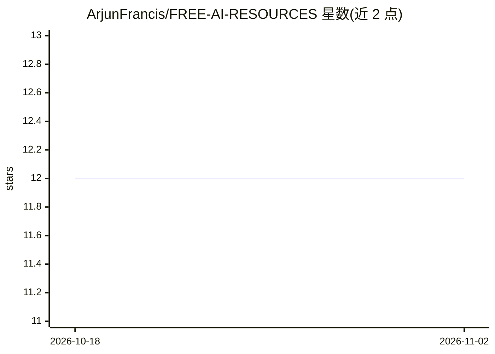

# ArjunFrancis/FREE-AI-RESOURCES

⭐ 12 · MIT · 推送 2026-02-28 · [GitHub](https://github.com/ArjunFrancis/FREE-AI-RESOURCES) · 个人维护

**725+ 免费 AI/ML 学习资源策展清单（课程/论文/工具/数据集）**

个人维护的免费 AI/ML 资源聚合仓库：收录 725+ 条课程、论文、工具与数据集，按数学基础、NLP、生成式 AI、机器人、医疗 AI 等 32 个类别组织，并标注难度与时长。提供面向初学者、进阶者、研究者与行业人士的多条学习路径（NLP/CV/MLOps/机器人/AI 研究共 5 条）。资源要求 100% 免费、URL 可访问（HTTP 200 验证），MIT 许可，通过社区贡献添加条目。

## 筛选速览

| 维度 | 判定 | 备注 |
|---|---|---|
| AI 角色 | `ai-knowledge` | 知识聚合/清单类 |
| 许可风险 | `permissive` | MIT |
| 部署形态 | `None` |  |
| 模型依赖 | — | README 未给出锁定关系 |
| 硬件要求 | — | 无带数字的原话,不猜 |
| 安装摩擦 | `low` | 无编译、无系统依赖或容器化 |
| 成熟度 | — | 结构信号不足 |

## 能力要点

- 725+ 条资源分布于 32 个类别，标注难度（初/中/高）与时长
- 5 条完整学习路径：NLP、计算机视觉、MLOps、机器人、AI 研究
- 收录 MIT/Stanford/Harvard/Berkeley 等 20 个大学项目资源
- 贡献规范要求资源 100% 免费且 URL 经 HTTP 200 验证

## 适用场景

- 按难度和目标查找免费的 AI/ML 课程与教材
- 规划从入门到特定方向（如 NLP、MLOps）的学习路线
- 查找特定领域（医疗、金融、机器人）的 AI 学习资源

## 场景标签

`精选清单` · 领域:学习与行业

## 证据(README 行号)

> L3: > Your complete gateway to **725+ free AI/ML courses, papers, tools, and datasets** for beginners to advanced learne
> L15: |**Total Resources**|725+|Across all categories|
> L16: |**Total Categories**|32|Organized by topic & type|

## 星数曲线

2026-10-18 12 → 2026-11-02 12（+0）

---
*卡片 v1 · prompt 1.4 · 生成 2026-11-01 · 置信度 high · 依据 README sha `4ae1aad403c8` · [字段定义](../../DATASET.md)*
