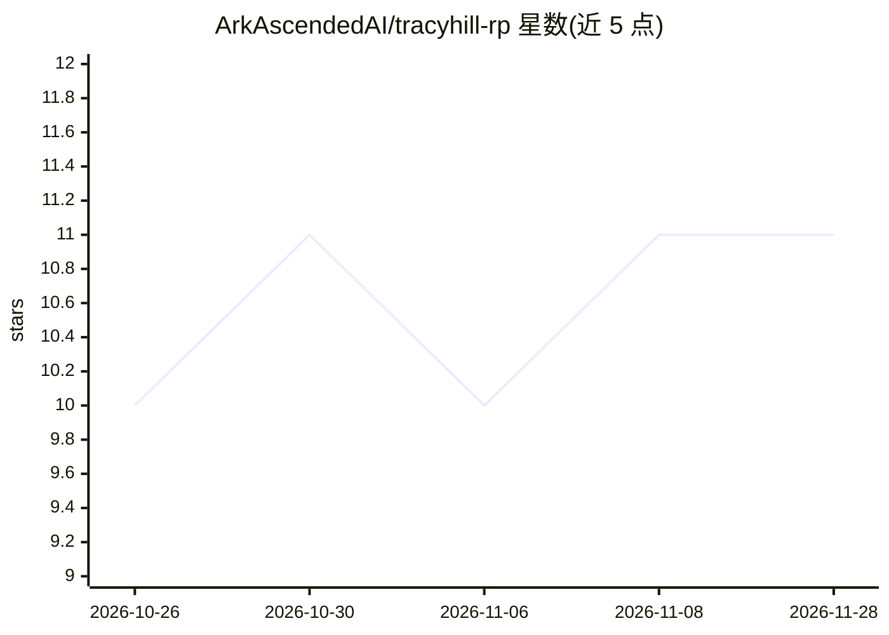

# ArkAscendedAI/tracyhill-rp

⭐ 11 · TypeScript · MIT · 推送 2026-11-12 · [GitHub](https://github.com/ArkAscendedAI/tracyhill-rp) · [官网](https://rp.tracyhill.net) · 组织维护

**自托管多用户 LLM 客户端，面向长篇协作小说与角色扮演**

面向长篇角色扮演工作流的自托管多用户聊天客户端：以战役为单位管理系统提示、lorebook 知识库与版本历史，由队列 worker 从玩家保留的回复增量维护世界状态（差异更新、重复检测、条目合并归档、故事线索追踪）。上下文引擎按关键词与语义激活检索 lorebook 条目并按 token 预算裁剪，配合场景标记与在场角色校验。服务端代理所有 provider 调用使密钥不出服务器，SQLite 存储，Docker 部署，MIT 许可，提供在线演示站点。

## 筛选速览

| 维度 | 判定 | 备注 |
|---|---|---|
| AI 角色 | `ai-native` | 本体是模型或模型工具 |
| 许可风险 | `permissive` | MIT |
| 部署形态 | `self-host` | docker 或自建部署 |
| 模型依赖 | local-ok | 支持本地模型 |
| 硬件要求 | — | 无带数字的原话,不猜 |
| 安装摩擦 | `low` | 无编译、无系统依赖或容器化 |
| 成熟度 | — | 结构信号不足 |

## 能力要点

- 接入十家 API provider，并支持登录个人 Claude/ChatGPT 订阅
- lorebook 状态维护流水线：滚动差异、重复检测、合并归档、线程追踪
- 多信号上下文检索引擎：关键词激活、嵌入语义激活、HyDE 扩展、预算裁剪
- 会话中途一键切换模型，模型目录集中维护于 packages/model-catalog

## 适用场景

- 和小圈子朋友一起跑长篇协作角色扮演战役
- 用自己的 Claude 或 ChatGPT 订阅账号驱动多人聊天服务
- 为含角色、地点、设定的长篇故事维护结构化世界状态

## 场景标签

`聊天机器人` `AI 写作` `知识库管理` · 领域:对话与助手

## 证据(README 行号)

> L3: **A self-hosted, multi-user LLM chat client built for long-form collaborative fiction and roleplaying.**
> L5: TracyHill RP is built around the way long-form roleplay works: persistent campaigns, structured world state, version
> L7: The server makes every provider call, so provider keys never reach the browser. It is SQLite-backed, deploys with Do

## 星数曲线

2026-10-26 10 → 2026-11-28 11（+1）

---
*卡片 v1 · prompt 1.4 · 生成 2026-11-19 · 置信度 high · 依据 README sha `bf833f57ef15` · [字段定义](../../DATASET.md)*
