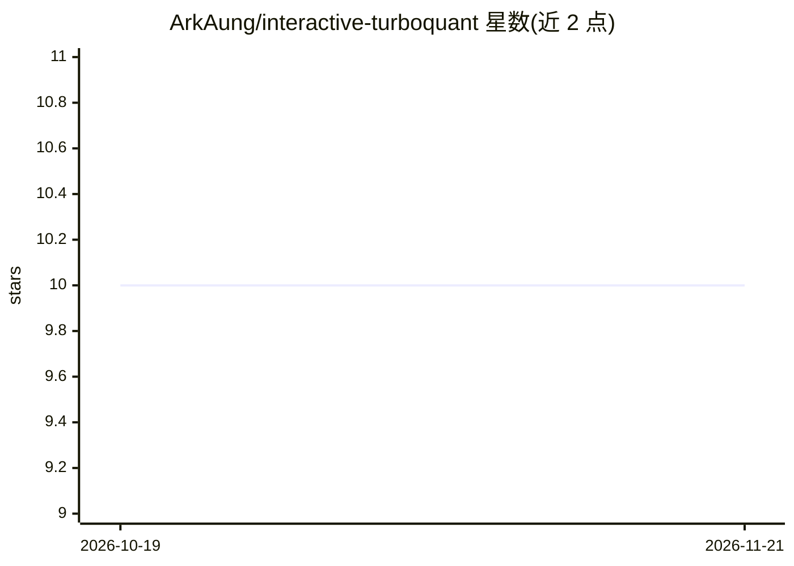

# ArkAung/interactive-turboquant

⭐ 10 · HTML · 推送 2026-05-02 · [GitHub](https://github.com/ArkAung/interactive-turboquant) · [官网](https://arkaung.github.io/interactive-turboquant/) · 个人维护

**TurboQuant 量化算法的交互式单文件讲解页面**

针对 Google Research 的 TurboQuant 算法制作的交互式讲解页面：以可视化方式呈现将 AI 向量压缩至每通道 3.5 bit 的旋转技巧，并说明其失真度与 Shannon 下界常数因子关系的证明。单 HTML 文件实现，浏览器打开即用，无构建步骤；交互演示依赖拖拽与悬停操作，建议在桌面浏览器查看。

## 筛选速览

| 维度 | 判定 | 备注 |
|---|---|---|
| AI 角色 | `ai-knowledge` | 知识聚合/清单类 |
| 许可风险 | `none` | — |
| 部署形态 | `None` |  |
| 模型依赖 | — | README 未给出锁定关系 |
| 硬件要求 | — | 无带数字的原话,不猜 |
| 安装摩擦 | `low` | 无编译、无系统依赖或容器化 |
| 成熟度 | — | 结构信号不足 |

## 能力要点

- 单文件 index.html，浏览器打开即用，无构建步骤
- 交互式演示 TurboQuant 的旋转技巧与 3.5 bit/通道压缩
- 讲解可证失真界与 Shannon 下界的关系

## 适用场景

- 直观理解 TurboQuant 量化算法的原理
- 教学中演示向量压缩的旋转技巧

## 场景标签

`模型量化` `教程课程` · 领域:学习与行业

## 证据(README 行号)

> L3: An interactive, single-file explainer for Google Research's TurboQuant algorithm: the rotation trick that compresses
> L11: Open `index.html` in a browser. No build step.

## 星数曲线

2026-10-19 10 → 2026-11-21 10（+0）

---
*卡片 v1 · prompt 1.4 · 生成 2026-11-20 · 置信度 high · 依据 README sha `9a0fa67d36c1` · [字段定义](../../DATASET.md)*
