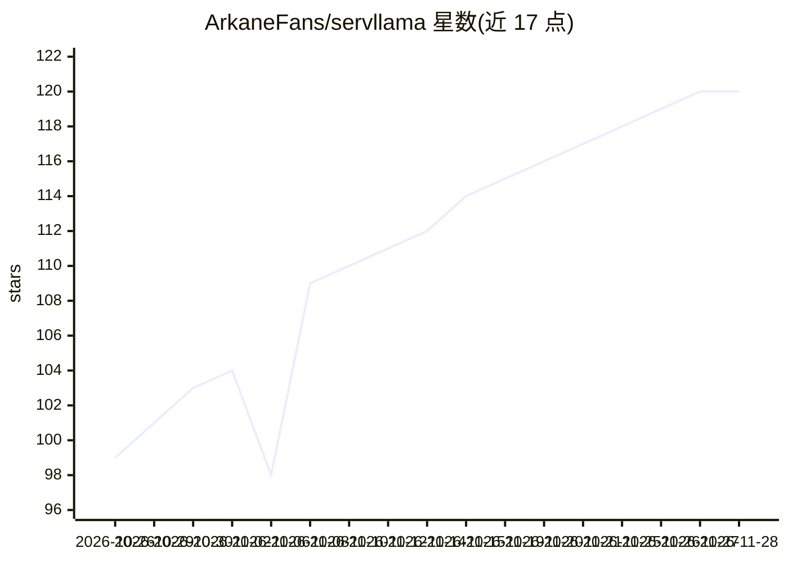

# ArkaneFans/servllama

⭐ 120 · Dart · AGPL-3.0 · 推送 2026-11-23 · [GitHub](https://github.com/ArkaneFans/servllama) · 组织维护 · 中文 README

**集成本地与云端模型的 Android AI 聊天应用**

开源 Android 应用，在同一应用内接入设备端 GGUF/MNN 模型与 OpenAI 兼容/Anthropic/Gemini 云端 API，支持离线对话、多助手配置、流式回复与图片输入。内置两个推理引擎（llama.cpp 与 MNN），可从 Hugging Face 和 ModelScope 发现并下载模型；还能把手机变成 OpenAI 兼容的本地 LLM 服务器供其他客户端调用，并提供离线语音转写与合成（sherpa-onnx/CrispASR）。要求 Android 9 及以上、64 位 ARM 设备，通过 GitHub Releases 分发 APK。

## 筛选速览

| 维度 | 判定 | 备注 |
|---|---|---|
| AI 角色 | `ai-native` | 本体是模型或模型工具 |
| 许可风险 | `viral` | AGPL-3.0 |
| 部署形态 | `None` |  |
| 模型依赖 | local-ok | 支持本地模型 |
| 硬件要求 | — | 无带数字的原话,不猜 |
| 安装摩擦 | `low` | 无编译、无系统依赖或容器化 |
| 成熟度 | — | 结构信号不足 |

## 能力要点

- llama.cpp（GGUF）与 MNN 双推理引擎，支持离线聊天
- 可将手机发布为 OpenAI 兼容本地 LLM 服务器（LAN 访问、可选 API-key 认证）
- 离线语音工作坊：语音转文字（导出 TXT）与文字转语音（导出 WAV）
- 支持内置工具、技能导入与远程 HTTP/SSE MCP 服务器接入

## 适用场景

- 无网络环境下用手机本地模型聊天
- 把手机当本地 LLM 服务器，给局域网内其他 OpenAI 兼容客户端提供接口
- 离线转写录音或为文本合成语音
- 同时管理多个云端 API 服务与本地模型的日常对话

## 场景标签

`聊天机器人` `语音识别` `语音合成` · 领域:对话与助手

## 证据(README 行号)

> L17: ServLlama is an open-source Android AI app that integrates local models and cloud providers in one place. You can c
> L74: - **Two inference engines:** llama.cpp for GGUF files, and MNN for complete MNN model directories.
> L17: ServLlama is an open-source Android AI app that integrates local models and cloud providers in one place. You can c

## 星数曲线

2026-10-26 99 → 2026-11-28 120（+21）

---
*卡片 v1 · prompt 1.4 · 生成 2026-11-28 · 置信度 high · 依据 README sha `4cebafd1353b` · [字段定义](../../DATASET.md)*
