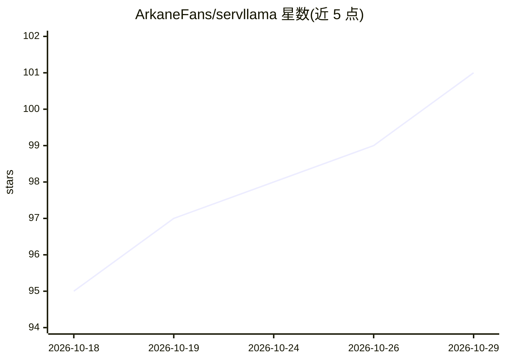

# ArkaneFans/servllama

⭐ 101 · Dart · AGPL-3.0 · 推送 2026-10-28 · [GitHub](https://github.com/ArkaneFans/servllama) · 个人维护 · 中文 README

**安卓手机一键本地 LLM 服务器：无需 Termux，OpenAI 兼容 API**

基于 Flutter 的 Android 应用，将手机变为本地 LLM 服务器：集成模型发现与下载（Hugging Face 与 ModelScope 同搜）、llama.cpp 与 MNN 双推理引擎切换、OpenAI 兼容 API 服务（/v1/models、/v1/chat/completions，支持流式与 API key）、内置聊天界面（流式输出、Markdown、视觉模型图片输入）以及日志查看与服务器配置。推理在本机运行，同机或局域网应用可调用。要求 Android 9+ 与 64 位 ARM 设备；厂商可能限制后台服务，监听全部网卡时需自设 API key。

## 筛选速览

| 维度 | 判定 | 备注 |
|---|---|---|
| AI 角色 | `ai-ecosystem` | LLM/agent 周边工具 |
| 许可风险 | `viral` | AGPL-3.0 |
| 部署形态 | `None` |  |
| 模型依赖 | local-ok | 支持本地模型 |
| 硬件要求 | — | 无带数字的原话,不猜 |
| 安装摩擦 | `medium` | 含编译或系统依赖之一 |
| 成熟度 | — | 结构信号不足 |

## 能力要点

- llama.cpp 与 MNN 双推理引擎，分别支持 GGUF 与 MNN 模型
- OpenAI 兼容 API 服务（流式响应、可选 API key、后台保活）
- 应用内模型发现：同时搜索 Hugging Face 与 ModelScope
- 完整聊天体验：流式输出、Markdown/代码块、视觉模型图片输入

## 适用场景

- 把闲置安卓手机变成局域网 LLM API 服务器，供其他 AI 客户端调用
- 在手机上直接下载并对话 GGUF 或 MNN 模型，全程无需 Termux
- 为本地网络内多个应用提供统一的模型推理服务

## 场景标签

`聊天机器人` `推理引擎` · 领域:对话与助手

## 证据(README 行号)

> L14: ServLlama turns your Android device into a self-contained local LLM server, combining model discovery and downloads
> L21: - OpenAI-compatible API serving: core support for `GET /v1/models` and `POST /v1/chat/completions`, including strea

## 星数曲线

2026-10-18 95 → 2026-10-29 101（+6）

---
*卡片 v1 · prompt 1.4 · 生成 2026-10-23 · 置信度 high · 依据 README sha `5ed25378b28a` · [字段定义](../../DATASET.md)*
