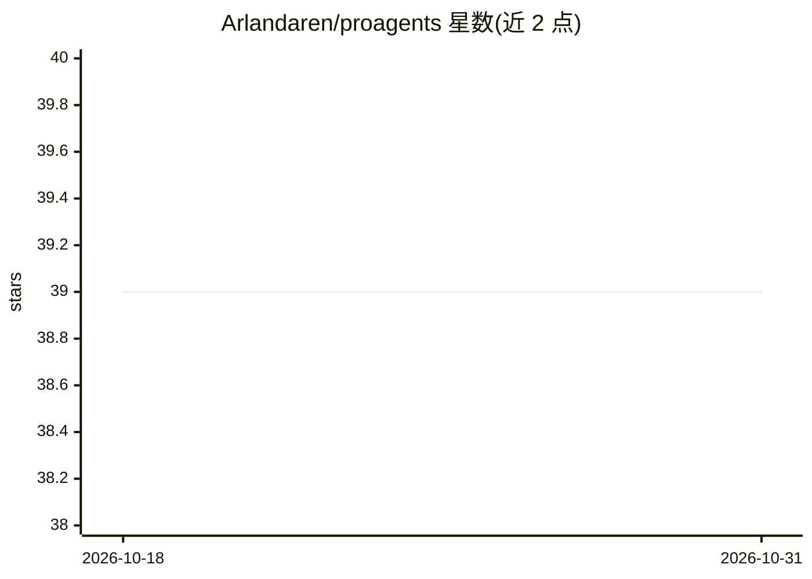

# Arlandaren/proagents

⭐ 39 · Python · MIT · 推送 2026-06-02 · [GitHub](https://github.com/Arlandaren/proagents) · 个人维护 · 中文 README

**面向 AI 代码编辑器的系统提示词/人格/工作流库（794 条）**

从 6 个开源 agent 框架提炼的 794 条系统提示词资源库：含 232 个 agent 人格（工程/设计/运营/商业/专业领域）、521 个工作流清单、41 个规则与风格文件，覆盖 11 个领域。提供 CLI 安装器，将单条文件以 .cursorrules、CLAUDE.md 追加或 stdout 输出等方式装入 Cursor、Claude Code、Windsurf、Zed、Gemini CLI 等 AI IDE；通过 git clone 源码运行，无 pip 依赖。MIT 许可，原始出处保留在 CREDITS.md。

## 筛选速览

| 维度 | 判定 | 备注 |
|---|---|---|
| AI 角色 | `ai-knowledge` | 知识聚合/清单类 |
| 许可风险 | `permissive` | MIT |
| 部署形态 | `library` | 以包/库形式分发 |
| 模型依赖 | — | README 未给出锁定关系 |
| 硬件要求 | — | 无带数字的原话,不猜 |
| 安装摩擦 | `low` | 无编译、无系统依赖或容器化 |
| 成熟度 | — | 结构信号不足 |

## 能力要点

- 794 条提示词资源 = 232 人格 + 521 工作流 + 41 规则文件
- 单条 CLI 命令安装到 Cursor/Claude Code/Windsurf/Zed/Gemini CLI
- 从 6 个开源 agent 框架整合，保留原始署名
- 无包装层、无遥测、无依赖，纯 Markdown 文件

## 适用场景

- 给 Cursor 或 Claude Code 配备资深工程师人格与代码审查规则
- 用 TDD、部署、安全合规等工作流清单约束 AI 编码流程
- 通过 taste 规则文件控制模型生成代码与 UI 的风格

## 场景标签

`提示工程` `精选清单` · 领域:Agent 开发

## 证据(README 行号)

> L16: **proagents** is a curated, prefix-free library of **794 professional system prompts, agent personas, and task work
> L156: ### Cursor
> L165: ### Claude Code

## 星数曲线

2026-10-18 39 → 2026-10-31 39（+0）

---
*卡片 v1 · prompt 1.4 · 生成 2026-10-25 · 置信度 mid · 依据 README sha `7826abe7ba98` · [字段定义](../../DATASET.md)*
