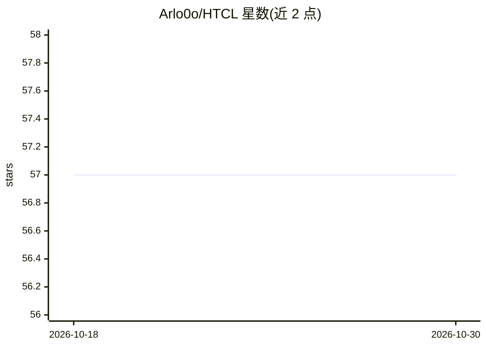

# Arlo0o/HTCL

⭐ 57 · Python · Apache-2.0 · 推送 2026-02-27 · [GitHub](https://github.com/Arlo0o/HTCL) · [官网](https://github.com/Arlo0o/HTCL) · 组织维护

**相机 3D 语义场景补全研究代码：分层时序上下文学习 (HTCL)**

ECCV 2024/TPAMI 论文 HTCL 的官方 PyTorch 实现：面向相机输入的 3D 语义场景补全（SSC），将时序上下文学习分解为跨帧亲和度度量与基于亲和度的动态细化两步，用于预测 3D 布局。提供 SemanticKITTI 数据准备脚本、预训练模型、单/多 GPU 训练与评估命令及 mayavi 可视化工具。安装基于 mmdetection3d 生态，提供 A100 预打包环境与分步安装两条路径，Python 限 3.7。

## 筛选速览

| 维度 | 判定 | 备注 |
|---|---|---|
| AI 角色 | `ai-native` | 本体是模型或模型工具 |
| 许可风险 | `permissive` | Apache-2.0 |
| 部署形态 | `library` | 以包/库形式分发 |
| 模型依赖 | — | README 未给出锁定关系 |
| 硬件要求 | — | 无带数字的原话,不猜 |
| 安装摩擦 | `medium` | 含编译或系统依赖之一 |
| 成熟度 | — | 结构信号不足 |

## 能力要点

- 官方 PyTorch 实现（ECCV 2024/TPAMI）
- 两步分层时序上下文学习：跨帧亲和度量 + 动态特征采样细化
- 提供 A100 预打包环境与分步安装说明
- SemanticKITTI 数据准备脚本、预训练模型与训练/评估/可视化命令

## 适用场景

- 在 SemanticKITTI 上复现论文的训练与评估
- 做相机 3D 语义场景补全的时序建模研究
- 可视化模型的场景补全预测结果

## 场景标签

 · 领域:计算机视觉/自动驾驶

## 证据(README 行号)

> L10: ### Abstract:
> L11: Camera-based 3D semantic scene completion (SSC) is pivotal for predicting complicated 3D layouts with limited 2D im

## 星数曲线

2026-10-18 57 → 2026-10-30 57（+0）

---
*卡片 v1 · prompt 1.4 · 生成 2026-10-24 · 置信度 mid · 依据 README sha `8e373e66bf23` · [字段定义](../../DATASET.md)*
