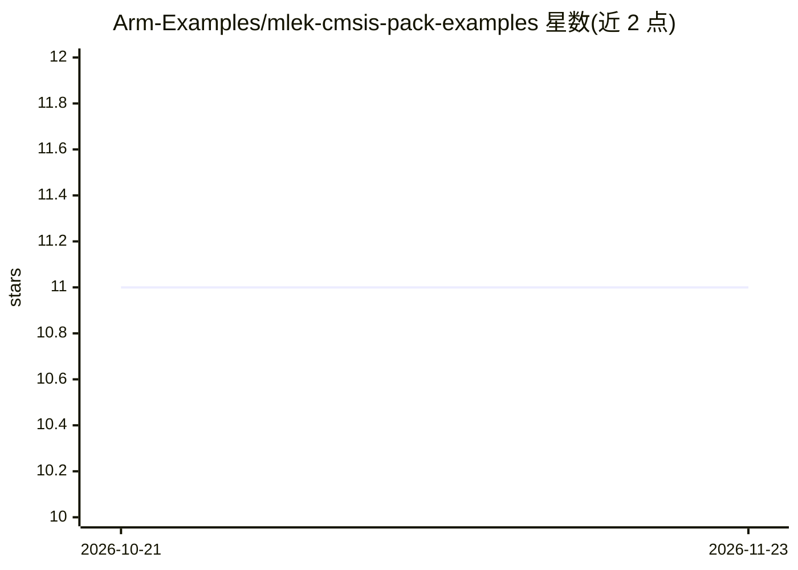

# Arm-Examples/mlek-cmsis-pack-examples

⭐ 11 · C++ · Apache-2.0 · 推送 2026-07-14 · [GitHub](https://github.com/Arm-Examples/mlek-cmsis-pack-examples) · [官网](https://github.com/Arm-Examples/mlek-cmsis-pack-examples) · 组织维护

**面向嵌入式开发者的 CMSIS-Pack 端侧 ML 示例集**

基于 ML Embedded Evaluation Kit 的 CMSIS-Pack 收录两个端到端示例：图像目标检测（192x192 输入，输出边界框坐标）与语音关键词检测（最多 12 个关键词）。目标平台覆盖 Corstone-300/310/315/320 虚拟或物理硬件及 Ethos-U55/U65/U85 NPU 变体，另支持 STM32F746、NXP FRDM-K64F 等开发板。构建走 VS Code + Keil Studio 扩展或 CMSIS-Toolbox 命令行，默认在支持 NPU 的目标上使用 NPU，不支持的算子回退 CPU，模型经 Vela 编译器预优化；运行可在 Arm Virtual Hardware 仿真，无需实体板。

## 筛选速览

| 维度 | 判定 | 备注 |
|---|---|---|
| AI 角色 | `ai-knowledge` | 知识聚合/清单类 |
| 许可风险 | `permissive` | Apache-2.0 |
| 部署形态 | `library` | 以包/库形式分发 |
| 模型依赖 | — | README 未给出锁定关系 |
| 硬件要求 | — | 无带数字的原话,不猜 |
| 安装摩擦 | `medium` | 含编译或系统依赖之一 |
| 成熟度 | — | 结构信号不足 |

## 能力要点

- 目标检测与关键词检测两个端侧 ML 示例
- 支持 Corstone 系列虚拟/物理平台及全部 Ethos-U NPU 变体
- NPU 默认加速，不支持算子回退 CPU，模型经 Vela 预优化
- 可在 Arm Virtual Hardware 仿真运行，免实体板

## 适用场景

- 在 Arm Cortex-M / Ethos-U NPU 上跑通目标检测示例
- 在无实体开发板时用虚拟硬件仿真关键词检测
- 为 STM32/NXP 开发板编译烧录嵌入式 ML 应用

## 场景标签

`目标检测` `教程课程` · 领域:学习与行业

## 证据(README 行号)

> L11: This repository contains Machine Learning (ML) examples using the CMSIS-Pack from
> L46: The examples presented in this repository showcase how to build and deploy end-to-end Machine
> L47: Learning applications using existing code from various CMSIS-packs. These examples are built

## 星数曲线

2026-10-21 11 → 2026-11-23 11（+0）

---
*卡片 v1 · prompt 1.4 · 生成 2026-11-19 · 置信度 mid · 依据 README sha `05199071902e` · [字段定义](../../DATASET.md)*
