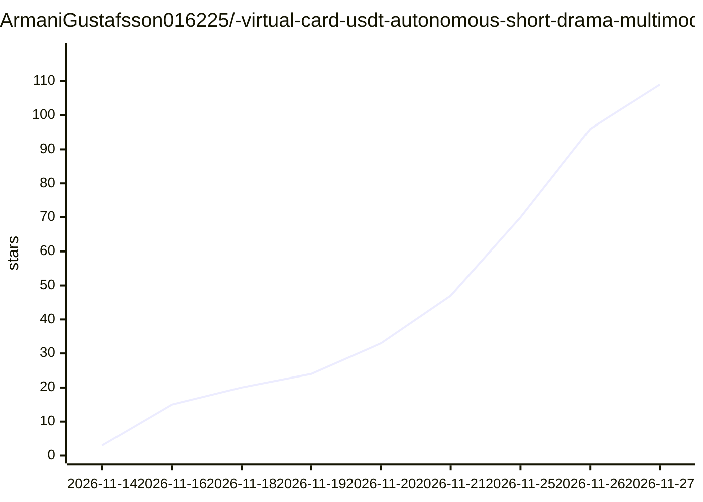

# ArmaniGustafsson016225/-virtual-card-usdt-autonomous-short-drama-multimodal-omni-vcc

⭐ 109 · 推送 2026-11-14 · [GitHub](https://github.com/ArmaniGustafsson016225/-virtual-card-usdt-autonomous-short-drama-multimodal-omni-vcc) · [官网](https://app.coregold.io/signup?invite_code=ADvlj9b) · 组织维护 · 中文 README

**推广 CoreGold 虚拟卡（VCC）+USDT 支付方案的营销文档，面向短剧出海团队**

仓库本体是一篇营销性质文档，无代码或可安装软件：以 2026 年多模态视频生成工具（Gemini Omni、Runway、Sora、可灵）的短剧出海渲染管线为背景，列出跨境大额订阅被拒、多账号卡指纹关联封号、项目结束难止损三类支付问题，随后介绍用 CoreGold 商业虚拟卡配合 USDT 充值与 Apple Pay 完成订阅支付、按席位发卡与一键销卡的流程。全文为该商业服务的导流内容，未提供任何安装或运行方式。

## 筛选速览

| 维度 | 判定 | 备注 |
|---|---|---|
| AI 角色 | `ai-knowledge` | 知识聚合/清单类 |
| 许可风险 | `none` | — |
| 部署形态 | `None` |  |
| 模型依赖 | — | README 未给出锁定关系 |
| 硬件要求 | — | 无带数字的原话,不猜 |
| 安装摩擦 | `low` | 无编译、无系统依赖或容器化 |
| 成熟度 | — | 结构信号不足 |

## 能力要点

- 内容为 CoreGold 虚拟卡服务的使用流程说明，非软件项目
- 围绕多模态视频渲染订阅的支付与多账号隔离场景组织
- 文末附官方控制台入口指向（仅哈希串，无有效链接）

## 适用场景

- 了解面向 AI 视频渲染订阅的虚拟卡支付流程叙述
- 查看多账号支付隔离方案的营销性描述

## 场景标签

 · 领域:跨境支付/营销内容

## 证据(README 行号)

> L2: 聚焦 2026 年 11 月新一代多模态音视频模型（Google Gemini Omni 1.2 Flash / Runway / Sora / 可灵海外版）在短剧出海、交互式广告与 3D 资产生成中的工业化管线，拆解高并发渲染扣费
> L36: 👉 **立即进入 CoreGold 官方开卡控制台**

## 星数曲线

2026-11-14 3 → 2026-11-27 109（+106）

---
*卡片 v1 · prompt 1.4 · 生成 2026-11-18 · 置信度 low · 依据 README sha `88c6a72df401` · [字段定义](../../DATASET.md)*
