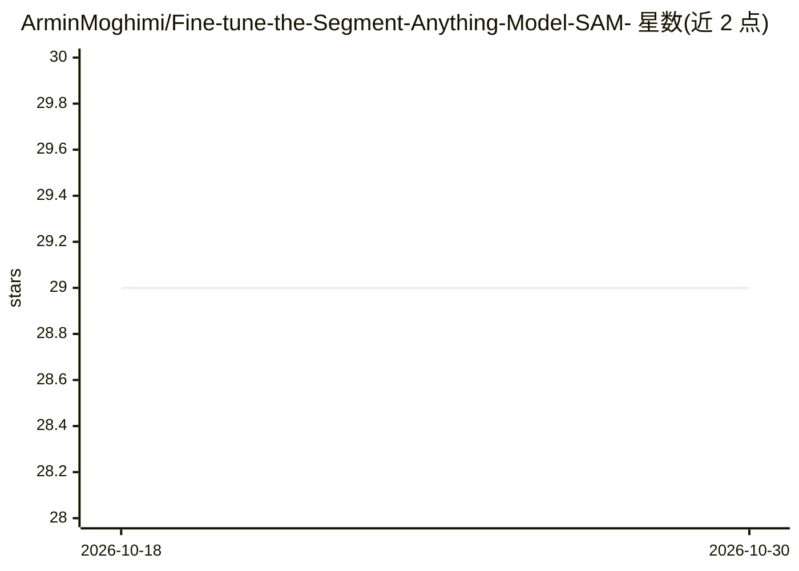

# ArminMoghimi/Fine-tune-the-Segment-Anything-Model-SAM-

⭐ 29 · Jupyter Notebook · 推送 2026-10-14 · [GitHub](https://github.com/ArminMoghimi/Fine-tune-the-Segment-Anything-Model-SAM-) · [官网](https://doi.org/10.1109/ACCESS.2024.3385425) · 个人维护

**微调 SAM 进行河流水体分割的代码库，配套论文数据集**

提供微调 Segment Anything Model (SAM) 的 Python 代码，用于从近距遥感影像中分割河流水体。工作基于发表于 IEEE Access 2024 的对比研究论文，论文中将 SAM 与 U-Net、PSPNet、DeeplabV3+、PAN、LinkNet 等深度学习模型在 LuFI-RiverSNAP.v1 数据集上进行了性能对比。README 提供三个 Colab 笔记本入口，数据集托管于 Kaggle、ISPRS 与 IEEE DataPort。代码声明可适配其他分割任务与遥感数据集；仓库未给出本地安装命令与依赖清单。

## 筛选速览

| 维度 | 判定 | 备注 |
|---|---|---|
| AI 角色 | `ai-native` | 本体是模型或模型工具 |
| 许可风险 | `none` | — |
| 部署形态 | `None` |  |
| 模型依赖 | — | README 未给出锁定关系 |
| 硬件要求 | — | 无带数字的原话,不猜 |
| 安装摩擦 | `low` | 无编译、无系统依赖或容器化 |
| 成熟度 | — | 结构信号不足 |

## 能力要点

- SAM 微调代码用于河流水体分割任务
- 配套 IEEE Access 2024 论文与 LuFI-RiverSNAP.v1 数据集
- 提供 Colab 笔记本（多处入口）
- 与 U-Net/PSPNet/DeeplabV3+ 等模型的结果对比展示

## 适用场景

- 微调 SAM 做遥感影像中的河流水体分割
- 复现论文的模型对比实验
- 作为其他遥感分割任务的适配起点

## 场景标签

`目标检测` `微调` · 领域:感知与多模态

## 证据(README 行号)

> L1: </head> <body> Fine-Tuning SAM (Segment anything) for River Water Segmentation Overview This repository presents the
> L3: ## The easy-to-use and adaptable code for river water and other segmentation tasks and use for other remote sensing 

## 星数曲线

2026-10-18 29 → 2026-10-30 29（+0）

---
*卡片 v1 · prompt 1.4 · 生成 2026-10-26 · 置信度 high · 依据 README sha `b6626a5b1446` · [字段定义](../../DATASET.md)*
