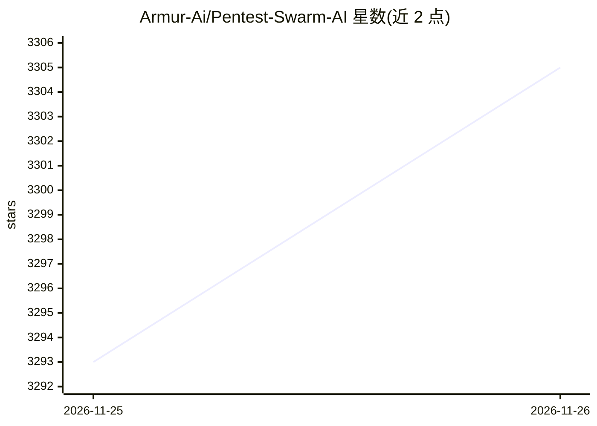

# Armur-Ai/Pentest-Swarm-AI

⭐ 3,305 · Go · AGPL-3.0 · 推送 2026-11-23 · [GitHub](https://github.com/Armur-Ai/Pentest-Swarm-AI) · [官网](https://armur.ai/open-source) · 组织维护

**自托管多智能体 AI 渗透测试平台，面向安全团队自动测试 Web 与 API**

用 Go 编写的开源自动化渗透测试平台：数十个 AI agent 通过共享 stigmergic 黑板协调，并发执行侦察、漏洞利用与报告，产出带证据、严重度、CVSS 的分级报告与可运行的 Python PoC。非 LLM 验证 oracle（OOB/差分/时序）对发现做实证确认。模型后端可选 Claude、Together AI 托管模型、Gemini、OpenAI 兼容接口或本地 Ollama/LM Studio。内置 fail-closed 作用域、出口管控、目标授权与审计日志；开源版（AGPL-3.0，alpha）限制部分能力，完整能力在商业托管平台。

## 筛选速览

| 维度 | 判定 | 备注 |
|---|---|---|
| AI 角色 | `ai-native` | 本体是模型或模型工具 |
| 许可风险 | `dual` | AGPL-3.0 |
| 部署形态 | `self-host` | docker 或自建部署 |
| 模型依赖 | local-ok | 支持本地模型 |
| 硬件要求 | — | 无带数字的原话,不猜 |
| 安装摩擦 | `low` | 无编译、无系统依赖或容器化 |
| 成熟度 | `idea` | |

## 能力要点

- 数十个 agent 经共享 stigmergic 黑板并发协调，触发谓词分散式运行
- 非 LLM 验证 oracle（OOB/差分/时序）对发现做实证确认并输出 VERIFIED 标记
- 每个确认发现附带沙箱内运行并校验的自包含 Python PoC
- 模型无关后端：Claude、Gemini、OpenAI 兼容、Together AI 或本地 Ollama/LM Studio

## 适用场景

- 让安全团队夜间对整个授权范围内资产做自动化渗透测试
- 在 CI/CD 流程中对 API 与 Web 应用做发布前安全门禁
- 对 GraphQL、OWASP Top 10、REST API 做专项安全检查
- 在本地/气隙环境运行渗透测试，数据不出内网

## 场景标签

`多智能体` `网络安全` · 领域:Agent 开发

## 证据(README 行号)

> L37: > **Pentest Swarm AI is an open-source, self-hosted automated penetration-testing platform built on a _real_ swarm.
> L41: > - 🧠 **Any model, self-hosted** — Claude, Together AI (GLM/Qwen/DeepSeek), Gemini, OpenAI-compatible, or **fully l
> L87: Run it on **any model** — Claude, anything OpenAI-compatible (incl. **Together AI**'s hosted Llama/Qwen/DeepSeek), 

## 星数曲线

2026-11-25 3,293 → 2026-11-26 3,305（+12）

---
*卡片 v1 · prompt 1.4 · 生成 2026-11-24 · 置信度 high · 依据 README sha `e3f4b0ef2af2` · [字段定义](../../DATASET.md)*
