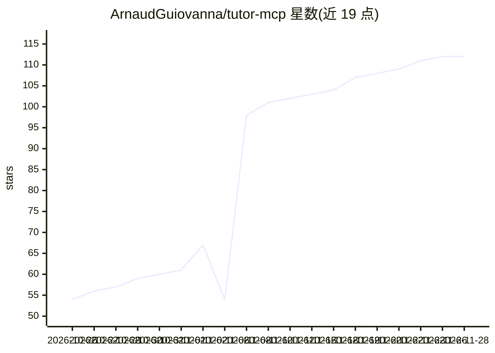

# ArnaudGuiovanna/tutor-mcp

⭐ 112 · Go · MIT · 推送 2026-11-23 · [GitHub](https://github.com/ArnaudGuiovanna/tutor-mcp) · [官网](https://tutor-mcp.dev/) · 个人维护 · 中文 README

**把 LLM 变成自适应辅导系统的 MCP 服务器**

基于 Model Context Protocol 的开源自适应学习引擎：用户选择科目与目标后，AI 生成技能图谱（概念、前置关系、目标），引擎负责持久化的教学决策。关键机制为「生成式教学+确定性教学法」：AI 负责对话与讲解，BKT 知识追踪、FSRS 间隔重复、前置条件规则与评估证据驱动下一步学习内容，并有叙事记忆跨会话保持上下文。支持本地 stdio 与远程 HTTPS/OAuth 接入，提供三种部署 profile（institution/Local/Hobby），配套 Windows 桌面客户端 Tutor ACP 支持机构内共享课程目录。

## 筛选速览

| 维度 | 判定 | 备注 |
|---|---|---|
| AI 角色 | `ai-native` | 本体是模型或模型工具 |
| 许可风险 | `permissive` | MIT |
| 部署形态 | `desktop` | 安装包/桌面程序 |
| 模型依赖 | — | README 未给出锁定关系 |
| 硬件要求 | — | 无带数字的原话,不猜 |
| 安装摩擦 | `low` | 无编译、无系统依赖或容器化 |
| 成熟度 | `idea` | |

## 能力要点

- BKT 知识追踪 + FSRS 间隔重复驱动确定性学习路径
- 学习引擎与叙事记忆两层持久化，跨 MCP 客户端共享历史
- 技能图谱自动生成，推荐决策可检视
- 三种部署 profile：institution/Local/Hobby

## 适用场景

- 让 Claude Code/Claude Desktop 等客户端成为个人 AI 家教
- 机构内共享课程目录并管理成员学习进度
- 在本地用 SQLite 保存个人学习历史并跨会话续学

## 场景标签

 · 领域:教育科技/LLM 工具

## 证据(README 行号)

> L15: **Tutor MCP is an open-source MCP engine for adaptive learning, self-learning and personalized AI tutoring.** Built
> L26: **Generative teaching. Deterministic pedagogy.** This is Tutor's defining engineering choice: the AI creates and ex
> L28: **Your learning engine travels across AI clients.** Use Claude Code, Claude Desktop, ChatGPT, Hermes, Pi (with an M

## 星数曲线

2026-10-26 54 → 2026-11-28 112（+58）

---
*卡片 v1 · prompt 1.4 · 生成 2026-11-28 · 置信度 high · 依据 README sha `ba0db0ae3a2a` · [字段定义](../../DATASET.md)*
