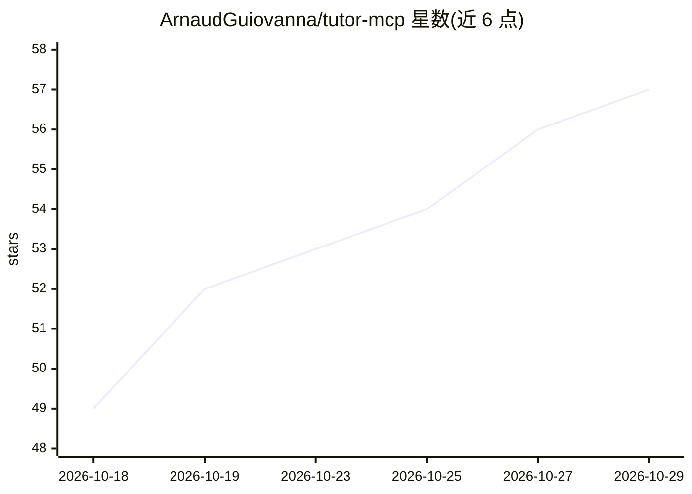

# ArnaudGuiovanna/tutor-mcp

⭐ 57 · Go · MIT · 推送 2026-10-28 · [GitHub](https://github.com/ArnaudGuiovanna/tutor-mcp) · [官网](https://tutor-mcp.dev/) · 个人维护

**把任意 LLM 变成自适应导师的 MCP 服务器**

开源 MCP 服务器（MIT，Alpha 阶段），为 Claude Desktop、Claude Code、ChatGPT、Gemini CLI 等 MCP 客户端接入一套持久化学习引擎：AI 负责讲解与练习，引擎用 BKT 知识追踪、FSRS 间隔重复与前置规则确定性地决定下一步学什么、复习什么、何时测评，并保存叙事记忆与学习历史。支持本地单二进制（SQLite）、个人 VPS 与机构级（PostgreSQL、OAuth）三种部署档位，二进制覆盖 Linux/macOS/Windows amd64 与 arm64，也可从 Go 源码构建。仓库还含基于 Tauri 的 Windows 桌面客户端。

## 筛选速览

| 维度 | 判定 | 备注 |
|---|---|---|
| AI 角色 | `ai-ecosystem` | LLM/agent 周边工具 |
| 许可风险 | `permissive` | MIT |
| 部署形态 | `desktop` | 安装包/桌面程序 |
| 模型依赖 | — | README 未给出锁定关系 |
| 硬件要求 | — | 无带数字的原话,不猜 |
| 安装摩擦 | `low` | 无编译、无系统依赖或容器化 |
| 成熟度 | `idea` | |

## 能力要点

- BKT + FSRS + 前置规则驱动的确定性学习引擎，决策可审查
- 跨 MCP 客户端复用同一学习历史（本地 stdio 或 HTTPS/OAuth 远程）
- Local/Hobby/Institution 三档部署，含 Docker Compose 与 systemd 方案
- 附 Tauri 桌面客户端，通过 ACP 连接 Codex

## 适用场景

- 在 Claude 或 ChatGPT 里让 AI 按我的目标生成课程并跟踪掌握度
- 跨多次对话延续同一门课的学习进度与复习计划
- 小型团队或机构以 VPS/共享服务方式运行自适应辅导

## 场景标签

 · 领域:教育科技/LLM 基础设施

## 证据(README 行号)

> L15: **Tutor MCP is an open-source MCP engine for adaptive learning, self-learning and personalized AI tutoring.** Built
> L22: **Generative teaching. Deterministic pedagogy.** This is Tutor's defining engineering choice: the AI creates and ex
> L24: **Your learning engine travels across AI clients.** Use Claude Code, Claude Desktop, ChatGPT, Hermes, Pi (with an M

## 星数曲线

2026-10-18 49 → 2026-10-29 57（+8）

---
*卡片 v1 · prompt 1.4 · 生成 2026-10-24 · 置信度 high · 依据 README sha `d6c972c68c6a` · [字段定义](../../DATASET.md)*
