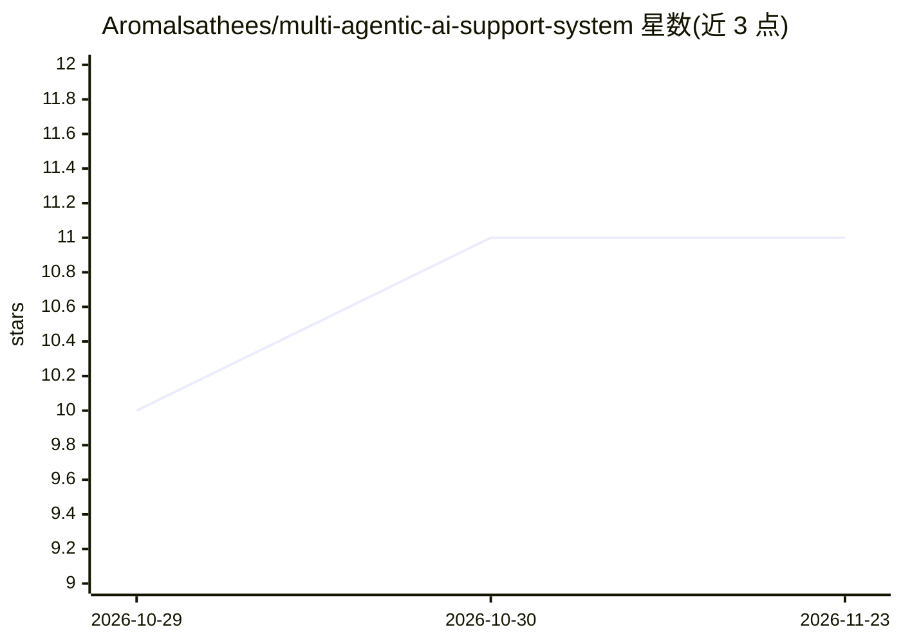

# Aromalsathees/multi-agentic-ai-support-system

⭐ 11 · HTML · 推送 2026-11-02 · [GitHub](https://github.com/Aromalsathees/multi-agentic-ai-support-system) · [官网](https://django-multi-agentic-ai-support-system.onrender.com) · 个人维护

**多智能体 AI 客服系统：自动应答、风控评估与实时监控**

名为 ARCHA 的多智能体客服系统，由三个协作 Agent 组成：客服 Agent 处理客户咨询、查询订单与退款记录、检索公司知识库并升级复杂案例；Manager Agent 评估退款与补偿决策；Risk Agent 评估可疑交易与欺诈风险。技术栈为 Python/Django 后端、LangChain 工作流编排、Anthropic Claude API、ChromaDB 向量库与 PostgreSQL，通过 RAG 从公司政策文档检索上下文，并经 SSE 提供实时响应流与 Admin 监控面板（查看工具调用、Agent 活动与会话日志）。

## 筛选速览

| 维度 | 判定 | 备注 |
|---|---|---|
| AI 角色 | `ai-native` | 本体是模型或模型工具 |
| 许可风险 | `none` | — |
| 部署形态 | `None` |  |
| 模型依赖 | locked-api |  |
| 硬件要求 | — | 无带数字的原话,不猜 |
| 安装摩擦 | `low` | 无编译、无系统依赖或容器化 |
| 成熟度 | — | 结构信号不足 |

## 能力要点

- 三个协作 Agent：客服、Manager 决策、风险评估
- RAG + ChromaDB 检索公司政策与知识文档
- SSE 实时响应流与 Admin 监控面板（工具调用/日志）
- 订单/交付核验、退款补偿决策与案例升级工作流

## 适用场景

- 为电商业务自动处理客户咨询与订单查询
- 对退款与补偿请求做风险感知的自动化决策
- 通过管理面板实时监控 AI Agent 的执行过程

## 场景标签

`多智能体` `RAG` `聊天机器人` · 领域:Agent 开发

## 证据(README 行号)

> L5:  An intelligent multi-agent AI system that automates customer support, evaluates potential fraud risks, retrieves co
> L21: ARCHA (Autonomous Reasoning and Customer Help Assistant) is the primary AI employee in a multi-agent customer suppo

## 星数曲线

2026-10-29 10 → 2026-11-23 11（+1）

---
*卡片 v1 · prompt 1.4 · 生成 2026-11-19 · 置信度 high · 依据 README sha `dce171cbb944` · [字段定义](../../DATASET.md)*
