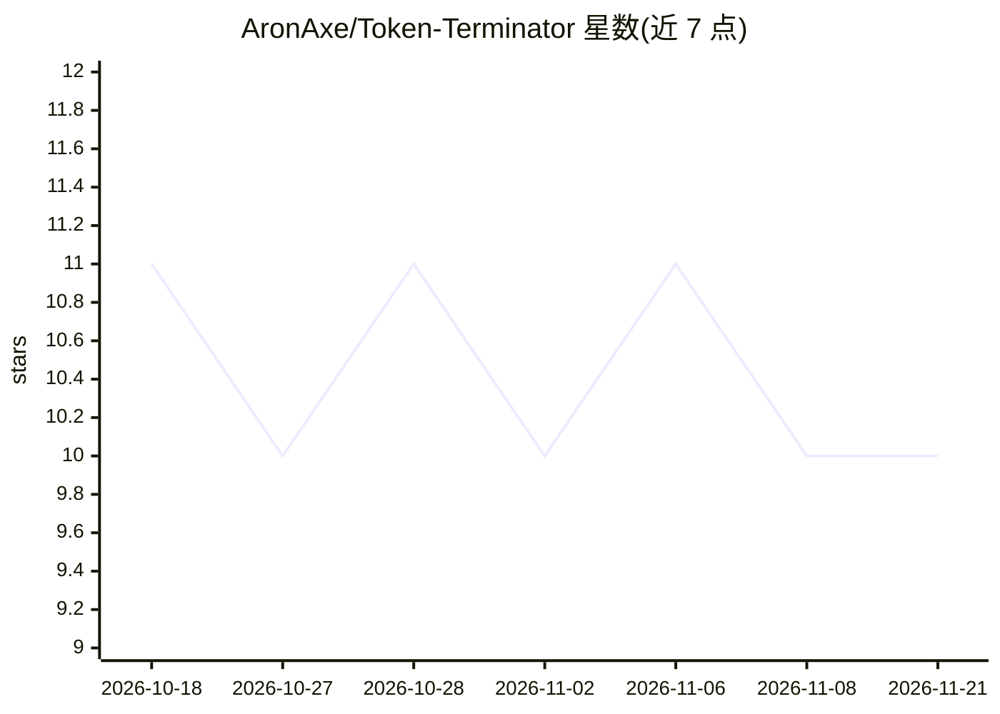

# AronAxe/Token-Terminator

⭐ 10 · Python · MIT · 推送 2026-10-07 · [GitHub](https://github.com/AronAxe/Token-Terminator) · [官网](https://aronbijl.com/services/ai-agents-systems#open-source) · 个人维护

**面向 agent 运行时的可移植 token 削减中间件，保留证据可恢复**

作为 agent-runtime 优化层运行，在工具结果与 provider 请求边界移除冗余 token，同时通过本地 SQLite vault、内容寻址存储与分层恢复视图保留底层证据并提供精确恢复；默认不替换宿主上下文引擎，失败时将原始请求原样返回（fail-open）。核心不绑定特定 agent：操作 Python 字典/字符串与请求标识，附带 Hermes 插件适配器，其他运行时需少量适配代码。含本地 dashboard（localhost:7474）与可选学习式省略风险策略（默认关闭）。

## 筛选速览

| 维度 | 判定 | 备注 |
|---|---|---|
| AI 角色 | `ai-ecosystem` | LLM/agent 周边工具 |
| 许可风险 | `permissive` | MIT |
| 部署形态 | `desktop` | 安装包/桌面程序 |
| 模型依赖 | — | README 未给出锁定关系 |
| 硬件要求 | — | 无带数字的原话,不猜 |
| 安装摩擦 | `low` | 无编译、无系统依赖或容器化 |
| 成熟度 | — | 结构信号不足 |

## 能力要点

- 工具结果/provider 请求边界的多机制削减（终端命令重写、时序增量压缩、确定性压缩、内容寻址 vault）
- 精确恢复保障与 fail-open：不可用时宿主收到原始请求
- 可移植核心：不绑定 Hermes，其他 agent 运行时通过小型适配器接入
- 本地只读 dashboard 与可选 CatBoost 省略风险策略（off/shadow/active）

## 适用场景

- 降低 agent 会话中重复工具结果带来的 token 消耗
- 为 Hermes agent 选择可替换的上下文引擎
- 在 localhost dashboard 上按 bot 统计输入节省与趋势

## 场景标签

`Agent 记忆` · 领域:Agent 开发

## 证据(README 行号)

> L20: Token Terminator is an agent-runtime optimization layer. It removes token bloat at the tool-result and provider-req
> L86: The reduction core is not intrinsically tied to Hermes: it operates on Python dictionaries, strings, stable request
> L90: In default middleware mode it does **not** replace the host context engine. In the explicitly selected v0.11.0 Cont

## 星数曲线

2026-10-18 11 → 2026-11-21 10（-1）

---
*卡片 v1 · prompt 1.4 · 生成 2026-11-20 · 置信度 high · 依据 README sha `865fdd9d41d6` · [字段定义](../../DATASET.md)*
