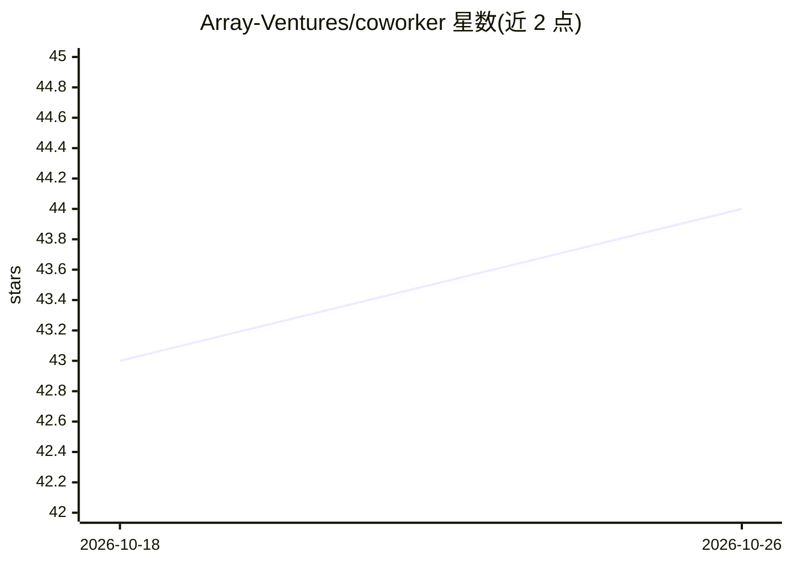

# Array-Ventures/coworker

⭐ 44 · TypeScript · Apache-2.0 · 推送 2026-02-25 · [GitHub](https://github.com/Array-Ventures/coworker) · [官网](https://railway.com/deploy/coworker) · 组织维护

**开源 AI agent 桌面应用：聊天助手、MCP 管理与应用构建**

基于 Mastra 与 Electron 构建的开源 AI agent，以聊天界面承担任务处理、问答与工作流管理，定位为团队中的 AI 成员。功能包括 AI 聊天助手、类 Lovable 的内部仪表盘/工具构建器（由 agent 维护并带 git 版本控制）、MCP 服务器可视化管理与注册表安装、ClawHub/skills.sh 技能市场、A2A 协议、Inngest 定时任务、Google Workspace 集成、WhatsApp 桥接与文件工作区。支持多模型提供方切换，自述为 OpenClaw 的替代。后端以 Bun 运行，提供 Docker Compose 与 Railway 一键部署。

## 筛选速览

| 维度 | 判定 | 备注 |
|---|---|---|
| AI 角色 | `ai-native` | 本体是模型或模型工具 |
| 许可风险 | `permissive` | Apache-2.0 |
| 部署形态 | `self-host` | docker 或自建部署 |
| 模型依赖 | — | README 未给出锁定关系 |
| 硬件要求 | — | 无带数字的原话,不猜 |
| 安装摩擦 | `low` | 无编译、无系统依赖或容器化 |
| 成熟度 | — | 结构信号不足 |

## 能力要点

- App builder：由 agent 维护、带 git 版本控制的内部工具构建
- MCP UI 与内置 MCP 服务器注册表
- 从 ClawHub 和 skills.sh 安装社区技能
- A2A 协议支持其他 agent 发现与通信

## 适用场景

- 通过聊天让 AI 处理任务、起草内容与管理邮件日历
- 搭建并维护内部仪表盘和小工具
- 通过 WhatsApp 或定时任务与 agent 交互

## 场景标签

`AI 助手` · 领域:对话与助手

## 证据(README 行号)

> L3: Open-source AI agent built with Mastra. Acts as an AI team member that handles tasks, answers questions, and manages
> L8: - **App builder** — Lovable-like builder for creating internal dashboards and tools, maintained by agents with git v
> L12: - **A2A protocol** — let other AI agents discover and communicate with Coworker via Agent-to-Agent protocol

## 星数曲线

2026-10-18 43 → 2026-10-26 44（+1）

---
*卡片 v1 · prompt 1.4 · 生成 2026-10-25 · 置信度 high · 依据 README sha `9d04cf1021b1` · [字段定义](../../DATASET.md)*
