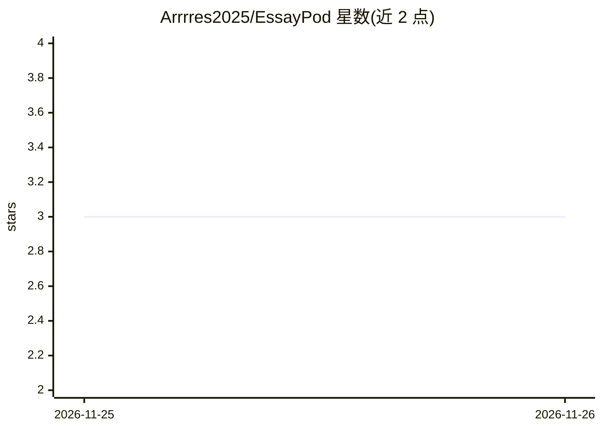

# Arrrres2025/EssayPod

⭐ 3 · Python · AGPL-3.0 · 推送 2026-10-20 · [GitHub](https://github.com/Arrrres2025/EssayPod) · 个人维护 · 中文 README

**面向学术用户的论文阅读与播客/视频内容生成平台**

本地优先的学术论文内容生产平台：导入 PDF 或 arXiv 链接后，并行生成审稿人式导读（LLM Agent 流式输出）、双语 Markdown 全文翻译、流式播客（含逐字稿与时间戳）以及论文讲解视频素材，并在内置 Video Studio 中编排导出 16:9/9:16 视频；同时增量构建知识图谱 Wiki（Source/Entity/Concept/Synthesis 页面）。后端 FastAPI、前端 React，提供 Web、CLI 与 macOS 应用壳三种使用方式。当前仍处本地开发阶段，无账号、云存储和生产数据库，播客与 Agent 依赖外部服务凭据。

## 筛选速览

| 维度 | 判定 | 备注 |
|---|---|---|
| AI 角色 | `ai-native` | 本体是模型或模型工具 |
| 许可风险 | `viral` | AGPL-3.0 |
| 部署形态 | `library` | 以包/库形式分发 |
| 模型依赖 | — | README 未给出锁定关系 |
| 硬件要求 | — | 无带数字的原话,不猜 |
| 安装摩擦 | `medium` | 含编译或系统依赖之一 |
| 成熟度 | `idea` | |

## 能力要点

- PDF 导入后并行生成导读、播客、翻译、Wiki 与视频素材
- YOLO 版面识别恢复阅读顺序并按 216 DPI 裁剪图表公式
- 流式播客约 10 秒缓存即可提前收听，支持断点恢复
- Video Studio 支持四区域拖拽布局、模板保存与 ASS 字幕

## 适用场景

- 导入论文后生成中文双语对照阅读材料
- 把论文转成可收听的播客与逐字稿
- 制作并导出论文讲解视频
- 在本地构建论文知识图谱并浏览实体关联

## 场景标签

`知识图谱` `文档解析` `视频生成` `语音合成` · 领域:内容生成

## 证据(README 行号)

> L9: EssayPod 是一个面向学术论文的 AI 阅读与内容生产平台。导入 PDF 后，系统会并行生成审稿人式导读、双语 Markdown 论文、流式播客及视频制作素材，并可在 Web Video Studio 中编排和导出论文讲解视频
> L136: - 文本 Agent：火山方舟 Ark（OpenAI-compatible API）
> L242: 4. 系统自动并行生成播客、审稿人导读、YOLO 媒体、双语论文和 LLM Wiki。

## 星数曲线

2026-11-25 3 → 2026-11-26 3（+0）

---
*卡片 v1 · prompt 1.4 · 生成 2026-11-24 · 置信度 high · 依据 README sha `f2e78c259d44` · [字段定义](../../DATASET.md)*
